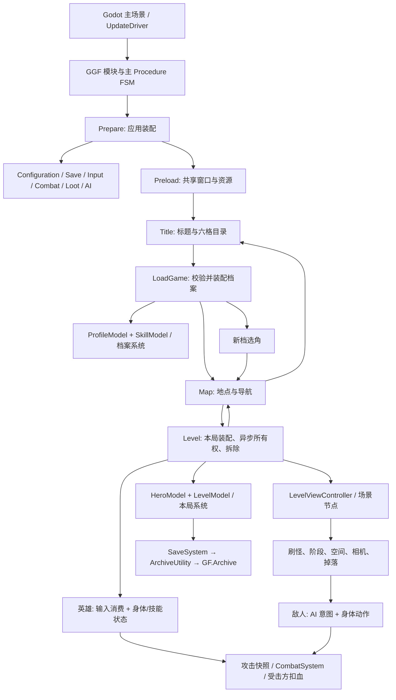
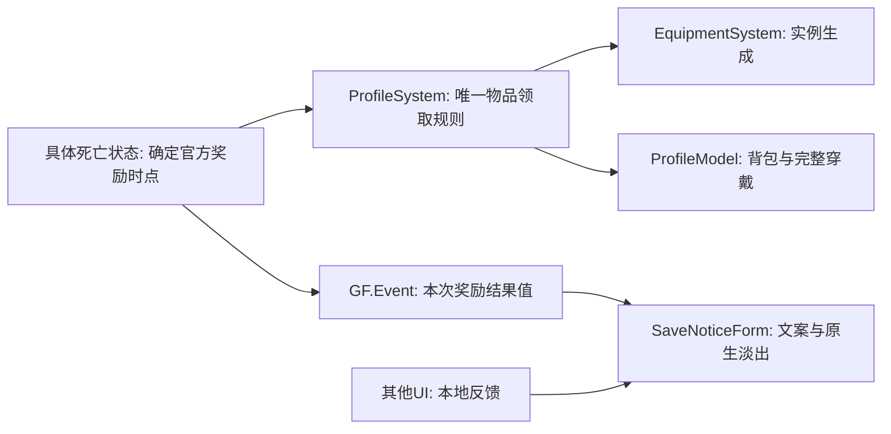

# Godot + GGF + QF 架构审计与整改

日期：2026-11-02。审计基线：`511b958eace86ee038409de068c5b4ce3e011334`。本报告是审计与实施记录，不覆盖 `ProjectGuidelines/`。用户要求对照GLM后实施，并继续完成全部审计结果。A01—A14及回归新增A15均有实施或有证据的保留结论；保留项不冒称已改造，低收益建议不机械变成新抽象。

## 1. 项目事实与调查范围

| 项目 | 实际证据与结论 |
| --- | --- |
| 引擎 | 本机 `Godot4CSharp_console.exe --version` 为 `4.7.2.stable.mono.official.ed1daf0bf`；`project.godot` 声明 4.7/C#/GL Compatibility，`GodotProject.csproj` 使用 `Godot.NET.Sdk/4.7.2`、`net10.0`。SDK 与实际引擎均核实，不能只从规范推断补丁版本。 |
| 语言与依赖 | 运行时业务主要 C#，EditorScripts 有 C#/GDScript，维护工具有 Python；NuGet 的 Newtonsoft.Json 为 13.0.4。GDScript 工具的存在不表示运行时有另一套玩法框架。 |
| GGF | 以源码随仓库保存于 `Godot/GodotProject/Framework/`，分纯 C# GameFramework 与 GodotGameFrameworkCore；GameFramework AssemblyVersion 为 0.0.0.0，版权指向 Jiang Yin。无独立子模块版本可证明其上游 Tag/Commit；不能猜测 UGF 或 GGF 发布版本。当前仓库 HEAD 是 `511b958eace86ee038409de068c5b4ce3e011334`，Framework Git tree 为 `14f480a66fcf600094052e7d10c1c95b9e05e252`，可精确追溯此次审阅快照。 |
| QF | 没有 QFramework 包引用；`GameScripts/Arch/` 是借鉴 QF 的本地契约、Bindable 与 GGF FSM 适配实现。不能把 QF 官方当前版本当成本项目依赖版本。既有上游研究见 `ArchitectureResearch.md`，本轮以本地实际实现为裁决依据。 |
| 启动/插件 | 主场景使用 `uid://bggentry001`；Autoload 为 UpdateDriver、SmokeTestDriver。启用 ComponentInsoector、ExportInspector、TopMenu、asset_bundle、ezpz_inspector。SmokeTestDriver 默认关闭驱动，只在命令行模式中启动隔离验证。 |
| 显示/物理/输入 | 940×590、canvas_items、gl_compatibility；2D 使用原生物理，项目中的 Jolt 配置属于 3D，不代表 2D 使用 Jolt。14 个具名业务物理层及 Ignore；A/D、J/K、空格、W、C/V、U/I/O 等动作由项目映射和 InputSystem 消费。 |
| 配置与资产 | Luban xlsx 是玩法配置源，GameProto/bytes 是生成物；动作、形状、声音时点归原生场景/AnimationLibrary，关卡配方与场景空间引用分离。工程没有以 TileMap 为核心的重复关卡管理器。 |

审阅范围覆盖启动与三种作用域、Arch 契约/注册、英雄身体与输入、技能/属性/状态效果、伤害两条命中路径、敌人/Boss 代表变体、刷怪/关卡/导航、装备/存档/UI、编辑器及维护工具。采用全域搜索和关键调用链源码核查；没有宣称逐帧人工检查全部美术资源，也没有把旧验证记录当成本轮执行结果。实际命令与结果统一登记在 `Validation.md`。

规范依据为第 00/10/20/30/40/50/60/70 章。审计发现的规范陈旧处仅报告，不自行修改规范：例如第 30 章仍有“其他 Boss/飞行怪待设计”的旧描述，而工程已经实现这些内容；`Godot/docs/` 的旧示例流程名、.NET 8 等也不能覆盖当前源码。

## 2. 整体评价与架构全景

总体结构适合继续演进，不需要替换框架或另建容器。最有价值的基础是：主 FSM 唯一保存注册对象；档案与本局分离；纯规则和 Godot 节点分离；攻击快照和伤害公式分离；原生动画拥有表现时序；SaveSystem/关卡事务拥有持久化与回滚。问题主要是少数边界遗漏和物种实现重复，而非框架方向错误。

不能据“零 TODO”、注释完整、测试数量或类型名断言没有补丁式设计；应以所有权、调用链和行为证据判断。当前没有确认到 P0，存在应先处理的 P1。长期扩展的风险是新增部位/物种时复制旧分支却漏改一处，法宝重领缺陷正是一个实例。

所有框中的注册成员依然只存于同一个主 FSM；图中的应用、档案、本局是成员生命周期，不是三套 Architecture。正常离关先取消在途任务、关闭窗口退订，再停场景/实体，逆序移除本局成员；返回标题再结束档案。独立 F6 场地使用自己的 FSM，不能借用主流程的本局状态。

数据与通信关系：Controller 读 Model，玩家修改经 Command→System；物理、AI 和已经开始的动作由状态/Entity 直接调用 System。持续变化用 Bindable；局部协作用直接调用/C# 事件；跨模块的一次事实用 GF.Event。事件参数分发后回池，不跨帧持有。UI 没有另存一套英雄属性。

## 3. Godot / GGF / QF 集成审查

| 层 | 推荐保留的职责 | 审计判断 |
| --- | --- | --- |
| Godot | SceneTree、Node/Resource、物理、Signal、AnimationPlayer、布局、Inspector、编辑器 | 已有成熟原生机制应继续直接使用；不把场景树替换成 System，不把动画再解释为代码时间线。 |
| GGF | Procedure/FSM、资源及场景加载、实体/UI 服务、声音、池与平台存档、跨模块事件 | 当前基本按组件 API 使用；Entity 池、NodePool、ReferencePool 分别管实体、局部效果节点、纯 C# 临时数据，职责不同，不因都是“池”就合并。 |
| 本地 QF 契约 | 数据所有权、业务规则、按类型取用、同步 Command/Query、Bindable | FsmArchitecture 是访问视图，实际数据不另存字典；不存在必须删除的第二个注册容器。GetModel/GetSystem 只限制获取能力，不强制返回对象只读，项目读写纪律仍需遵守。 |

注册事务在 `Arch/FsmArchitectureExtensions.cs:33` 之后通过 finally 移除旧条目，基类 Init 失败也清理。Deinit 失败继续抛异常有“明确报告契约损坏”的价值，不能为了标题继续打开就全局吞掉；若未来出现真实清理故障，应在拥有者执行剩余清理并保留原异常。当前既有钩子与测试不足以证明需要改异常策略。

`SkillSystem` 属档案生命周期，`HeroModel` 属本局生命周期。其 CancelSkill/ClearSkillDefinitions 等对 HeroModel 不存在的检查是有效跨生命周期边界，不是 GLM 所称可以整体删除的内部冗余。反之，同步帧内已校验的内部引用不应重复兜底。

API 文档有陈旧示例，新增调用必须核对本地 API；本轮核实了 EventManager 的 AllowNoHandler/AllowMultiHandler、Fire 下一轮分发、UI 按资源路径取窗及其空返回。没有新增第二个 EventBus、全局通知单例或 Manager。

## 4. 2D 动作游戏专项

| 系统 | 已有设计与结论 | 改进点 |
| --- | --- | --- |
| 玩家与输入 | InputSystem 管动作边沿、闩锁/组合、连段节奏；身体 FSM 管落地/空中/攻击/受击/捕获/死亡，具体悟空状态实现技能；死亡事实在扣血归零时置位。 | 已在同一类内提取冻结/中毒私有表现方法；不按行数拆新System，物理推进顺序保持。 |
| 伤害 | 出招冻结 CombatantAttributes/威力→当前几何复核→AttackData去重→ReceiveHit→CombatSystem.Calculate→英雄System或敌方实例扣血→值事件。 | 身体旧候选误伤已复现；身体与离身效果共用HurtBoxNode当前形状复核，后续结算仍各归其所有者。 |
| 敌人与 Boss | AI只提交意图，身体按物理帧执行；形态转换和外部效果完成在安全帧回收。不同Boss有实际差异。 | 龙王/牛魔人形移动及同协议死亡已共享；鲨魔低血动画、牛心时点、牛魔变身与鹏魔蛋态保留具体职责。 |
| 技能/属性/Buff | 配置定义、学习记录、激活记录、具体状态分离；属性来源汇总与冻结/中毒数据归英雄Model。 | 未发现可变运行态写共享配置Resource；不预建技能解释器/Buff编辑器。AI已按实际物种事实注入，不再下转具体Entity，也未扩成万能接口。 |
| 装备/法宝 | ProfileModel 唯一持有背包和完整 EquippedItems，EquipmentSystem 管随机与穿卸。 | TryCollectEquipment 遗漏 Treasure 的实例排重，是确认的资产所有权缺陷；必须补齐所有部位/所有英雄回归。 |
| 关卡/相机 | 配方/空间/并行调度/名额/实际相机抵达分工合理；进入序号、取消令牌和场景所有权处理迟到结果。 | 地图按钮/动画/提示已集中窗口内单表，导航与图鉴共用场景ID；没有把UI结构塞全局配置或增加隐藏关可见入口。 |
| 动画/特效/声音 | 原生轨道管视觉、判定窗口、声音键；回调登记请求，播放器返回后再换状态/回池。 | 保留具名 AnimEvent 与节点池所有权。技能特例的取整/随机调用次数不可未经依据统一；不把观察到的不同公式自动认定为伤害结算重复。 |
| UI/存档 | Form 按生命周期订退，流程管导航/异步；档案 DTO 为 v12，框架原子文件、备份回退、串行队列，进关快照/通关与死亡检查点/放弃回滚。 | 牛心死亡表现直接发资产并查 UI 窗口应拆开；Single() 不是业务提示的合理发现入口。正式档案不用于架构试验。 |

尚未实现的唐僧战斗、双人、任务/商店等不为审计清单凭空增加架构。现有法宝穿戴不等于已实现法宝主动攻击系统。

## 5. 代码质量、鲁棒性与编辑器

共享机制和物种特例总体边界成立。代表性重复包括移动 Tick、外部死亡效果等待、若干 Engage、无敌秒数倒计时、随机抽取表达式。优先解决同一不变量的多处维护，不能以删文件数量为指标。建议只给现有状态增加必要参数，避免“完成源策略+泛型状态+万能宿主”多层组合。

身体PollAttackOverlaps原先在没有攻击包时仍枚举节点，已早退。当前为共用形状复核，在装配时缓存固定子形状节点引用，避免每帧重查；几何仍是原生唯一状态。没有profiler数据，不声称已测得帧率提升；不增加全局对象池、几何副本或每帧服务快照。

存档异常分层必须准确：`ArchiveSystem.RunAfterAsync:274-295`已捕获IO异常并返回false；同步序列化/快照契约异常位于别处。检查点导航已用真实faulted Task注入验证，并由所属流程记录错误、按既有失败语义返回地图。不能给所有内部方法机械加catch，清理契约失败也不日志后假装成功。

C#命名、partial、XML与m_风格总体统一，继续复用CSharpStyle、引用校验、配置校验和生成器。首轮353文件扫描发现20个既有格式差异及ArchitectureLifecycleTests缺XML；续轮已整理，当前346文件无格式差异/缺XML。该结果支持可读性，不能证明接口合理。SoundExtensions依赖应用配置与“纯扩展”目录约定有张力，提案见10.4，不为目录整齐迁移全仓。

EditorScripts/维护导入器与玩法程序集入口分开，Tool/Inspector 代码须区分编辑器执行；一次性作者化脚本会写资源，不能自动重跑覆盖人工动作修正。现有原生形状、资源类型和 Export 引用足以支撑 Inspector；没有证据表明需要新 Dock/EditorPlugin。既有插件退出 Free/RID/ObjectDB 诊断另列，业务测试 PASS 不代表这些已解决，也不能在只读边界外私自修补。

## 6. 问题清单与优先级

以下目录路径相对 `Godot/GodotProject/TheGame/GameScripts/`；Procedure 文件位于 `TheGame/MainPack/Scripts/Procedure/`。行号是审计基线定位，首批整改后以方法名定位。仅列文件名时可按其唯一类名检索。确认程度不等于严重程度。

| ID / 问题 | 代码证据 | 根本原因 | 影响 | 优化方案 | 优先级 / 可信度 |
| --- | --- | --- | --- | --- | --- |
| A01 法宝实例可重复领取 | `Systems/ProfileSystem.cs:119-142`，TryCollectEquipment 仅检查三槽；`Models/Profile/ProfileModel.cs:284` 已有四槽 | 新部位加入后资产不变量入口遗漏 | 穿戴与背包双重归属，后续存档/卸装不变量被破坏 | 已补 Treasure，并用全部槽与非出战英雄测试；不改格式 | P1 / 已确认并修复 |
| A02 牛心死亡表现跨入资产和 UI | `Entity/Enemies/Bosses/zm1_10_bull_demon_valley/BullDemonHeartEntity.cs:153-177`，BeginDeathPresentation | 官方特殊奖励直接拼在表现方法 | 无提示窗或重复窗时 Single 抛异常中断死亡 Enter；规则难独立验证 | 已移入 ProfileSystem + 值事件；死亡状态保持演出开始即入包，窗口只消费结果 | P1 / 已确认并修复 |
| A03 技能提示遍历并要求唯一窗口 | `UI/SkillForm/SkillForm.Logic.cs:253,275` | UI 查找依赖集合形状 | 缺窗引发无关业务异常 | 已改按已有资源路径取窗，局部提示缺席不影响业务；不建通知服务 | P2 / 已确认并修复 |
| A04 身体与效果候选过滤不一致 | `AbstractActorEntity.OnHitBoxAreaEntered`、`HurtBoxNode.Intersects` | 命中管道分头演化 | 同物理步移动攻击形状后，旧候选可误伤700px外目标；CombatSide不是阵营 | 已真实复现并共用当前形状复核，先复核后登记去重；保留物理层阵营边界 | P2 / 已确认并修复 |
| A05 空攻击仍查询重叠 | `Entity/AbstractActorEntity.cs:770-785` | 缺少攻击存在前置门槛 | 无收益节点枚举；性能幅度未测 | 已在无包入口直接返回，保留主动攻击的全部检查 | P2 / 已确认并修复 |
| A06 行走状态复制 | `EnemyWalkState(Type)`与龙王、牛魔人形预设 | 攻击状态类型硬编码 | 运动规则修订多处同步 | 已共用现有Walk，删除两份Move及UID；鲨魔保留低血动画选择 | P2 / 已收敛 |
| A07 外部死亡效果等待复制 | `EnemyDeathState(bool waitForEffect)`及鲛/鲨/鹏死亡效果回调 | 完成回调消费模板重复 | 新物种复制清理流程 | 按用户追问合入现有死亡终态，删除三份死亡状态；保留普通尸体运动及真正不同的变身/奖励时点 | P2 / 已收敛 |
| A08 AI 规则下转具体节点 | 各物种Engage、`FlyingPursuitState`、`DistanceSkillEngageState`、`EnemyAiData` | 物种事实从宿主内部读取 | 纯 C# 测试覆盖无法自然扩展 | 注入只读距离/阶段/运动事实，消除状态内具体实体转型；三对相同Engage已合并 | P2 / 已收敛 |
| A09 地图平行地点清单 | `MapForm.InitializeLocations`、`MapLocationButton.LevelId` | UI 注册、动画与地点键各自维护 | 加地点需多处修改 | 单份按钮/动画绑定，导航与图鉴共用场景ID；初始化检查覆盖与动画，保持明确失败 | P2 / 已收敛 |
| A10 英雄物理循环表现内联 | `AbstractHeroEntity.RefreshFreezePresentation/RefreshPoisonPresentation` | 新状态表现逐步内联 | 阅读和改动扩散 | 已提同一类内的私有方法，保留伤害/输入/动画/移动顺序 | P2 / 已整理 |
| A11 效果威力抽取/舍入分散 | `Combat.xlsx`全部71条攻击及9处敌方显式Lerp | 源行为有多种表达；当前敌方范围均固定整数 | 分散确实存在，未发现当前伤害分布缺陷 | 核实55条敌方范围后保留局部公式和随机序列；不增加无实际收益的多舍入AttackRoll | P2 / 已核实，保留 |
| A12 异步边界/清理故障策略 | `ProcedureLevel.NavigateAfterCheckpointAsync`、架构生命周期测试、frontend故障注入 | 检查点faulted任务缺少拥有者处理 | 异常可能逃逸async void；正常IO已有false结果 | 已收口真正faulted任务，记录并按既有失败语义返回地图；Deinit仍显式报错并在finally移除 | P2 / 边界已修复，清理策略保留 |
| A13 六种无敌倒计时相似 | 龙/牛/鲛/鲨/鹏/鲨鱼实例计时与AnimEvent | 特殊角色分别实现 | 几行算式重复，但启动/退出和阶段语义不同 | 已核实各自产生者及暂停/死亡/复用；保留物种所有权，不扩大Enemy状态面 | P3 / 已评估，保留 |
| A14 规范/参考文档陈旧和目录张力 | 第30章“待设计”；Godot/docs旧示例；SoundExtensions | 实现演进快于索引 | 后续AI可能套错接口 | 更新提案见第10节；完成手写格式/XML整理和既有工具验证，不自行改规范或只读参考 | P3 / 已整理并记录提案 |
| A15 暂停当帧仍消费旧delta | `LevelViewController._Process`；完整UI的真实飞行球及暂停后正delta注入 | Engine.TimeScale变化晚于本帧delta采样，不能只假定暂停后的参数为零 | 关卡时钟和飞行掉落可额外推进一帧 | 唯一关卡帧入口读取现有GF.Base.IsGamePaused；双频验证旧delta、计时、球位置、恢复追踪 | P2 / 回归确认并修复 |

P0：本轮没有确认到严重全局架构缺陷，不能把尚未运行的压力/异常注入当作排除全部 P0 的证明。P1 先处理；P2 按具体行为链实施；P3 仅在相关功能开发时顺手收敛。

## 7. 与 GLM 报告的对照裁决

对照文件：`.kilo/plans/1793541042212-architecture-audit-refactor-plan.md`。独立检查同意其“保留整体架构、优先处理牛心跨层、重复须按家族核实”的方向；不接受绝对化评价代替证据。

| GLM 建议/结论 | 本轮裁决 |
| --- | --- |
| 牛心奖励解耦、技能 Single 风险、行走/死亡重复、地图多清单 | 采纳；奖励保持原时点，并优先复用 ProfileSystem，而不是新增 CombatManager/通知服务。 |
| 无 P0、总体可继续维护 | 作为当前证据下判断，不承诺无未发现缺陷；增加 A01 法宝资产所有权缺陷。 |
| 磁盘Task异常将使NavigateAfterCheckpoint崩溃 | 框架正常IO异常已转false；真正faulted任务已注入并由流程处理，结算返回地图和手动保存重读通过。没有把两类失败混称为一个框架缺陷。 |
| SkillSystem 七处判空全删 | 不采纳。档案 System 与本局 Model 生命周期不同，离关清理合法遇到 null。 |
| 删除三份 Boss MoveState，用 Walk 泛型预设统一 | 调整。龙王与牛魔人形可收敛，鲨魔还负责低血动画；且两者有自定义死亡预设，单独增加 Walk<T> 预设并不能直接替换其完整组合。 |
| 六种无敌全部下沉AbstractEnemyEntity | 核实后保留物种所有权：动画长度、秒数键、阶段门槛和效果代次各异，相关实机通过。与第30章具体敌人负责专属行为一致，不扩大所有敌人的状态面。 |
| 12处随机公式合为带舍入参数的 AttackRoll | 不按原案实施。离身攻击、捕获与身体攻击语义不同；多模式参数会隐藏差异。先按来源核实，保持样本次数与顺序。 |
| catch 后吞 Deinit 错误让标题继续装配 | 不采纳静默继续；移除 finally 已成立，当前需要的是故障所有者的明确策略。 |
| 把地图 throw 改为回退+日志 | 不采纳静默回退。配置/场景装配契约应在入口明确失败；集中绑定表能消除漏配原因。 |
| 零 TODO 说明无补丁、所有 async void 都已兜底、风格100%等 | 不作为证明。以源码、具体契约与本轮验证替换绝对断言。 |
| 每阶段无条件全量测试、每种小重复都抽帮助 API | 按风险选择；完成相关检查后不无意义重复，不为少量显然代码添加公共层。 |

## 8. 推荐目标架构与分阶段路线

新增接口只表达已有业务：唯一装备奖励返回“已拥有/领取成功/背包满”明确结果；随机源显式传入。死亡表现方法只停手/火柱与播放动画，不能决定背包容量、随机属性或窗口唯一性。奖励结果事件只携带值，不持有实体、档案或 UI。不存在需要统一包装所有框架 API 的适配层。

| 阶段 | 目标/范围 | 验收与风险 | 本轮范围 |
| --- | --- | --- | --- |
| 一：必须处理 | A01全部槽排重；A02牛心奖励拆开；A03提示取窗；A05无包早退 | 修前失败→修后测试；首次/重复/满包/缺提示/池复用、磁盘与前端 | 已完成 |
| 二：核心模块 | A06行走、A07死亡、A08纯规则边界；A04先复现再修复 | 删除旧实现；60/120Hz双向攻击、死亡/变身、尸体落地、特效完成、形状复核 | 已完成；真实差异保留 |
| 三：API/代码 | A09地图单表、A10私有表现、A11数值核实 | 三态图、隐藏探索、技能轨迹；引用/风格/XML；保留随机序列 | 已整理；A11证据支持保留 |
| 四：长期维护 | A12故障注入、A13收益评估、A14提案及既有工具 | faulted任务恢复/清理异常可追踪；工具不覆盖人工资源 | 已完成裁决与验证；规范/只读依赖不改 |

不值得重构：仅因行数拆四大基类；强制所有读取都走 Query；建立多个 Architecture；用事件代替同一拥有者直接调用；把所有 AI/身体接口扩成万能物种上下文；删除无消费者公共 API 作为高优先成果；为现有 Inspector 再建通用配置编辑器。

## 9. 后续 AI 的长期工程规则

这些是既有集中规范在当前工程的执行摘要，不是新的规范源：

1. 新增先写清事实所有者、唯一写入口、生命周期与表现边界，再决定是否需要 Model/System/接口。
2. 修改不变量需检查所有真实成员：装备要覆盖全部槽与所有英雄，不能照抄旧三字段检查；存档字段以当前源码与版本为准。
3. 先沿完整输入/动作/结算/反馈/保存链定位，再改职责；不要靠额外 flag、转发和兜底掩盖根因。
4. Godot 拥有树、物理、动画、布局；GGF 拥有服务与流程；QF 契约划分业务职责。保留唯一注册存储与唯一伤害公式。
5. 可变状态不写共享配置 Resource；攻击/事件按所有权回池，跨帧只持有复制值，异步检查原周期身份。
6. 边界严格、内部简洁；跨生命周期的 null 是合法状态，已证明的内部契约无需反复检查。错误不静默恢复为成功。
7. 共用语义先于共用语法；保留物种时序、舍入和随机调用顺序，不用万能参数化类掩盖真实差异。
8. 先复现高风险缺陷，验证外部可观察行为；不增加生产测试 API，不使用玩家正式档，不以编译代替物理/渲染检查。
9. 生成物走既有入口；Framework/addons/Luban/旧工程只读。规范冲突报告，维护规范另按用户明确授权处理。
10. 交付列明改动、规范依据、实际命令结果和未完成项；退出诊断与业务 PASS 分开记录，保留用户 Git 索引。

## 10. 实施结果与逐项收口

A01、A02、A03、A05已完成。法宝排重先复现出战/非出战英雄的4项失败，再补全Treasure；唯一奖励规则放入现有ProfileSystem，结果仍由背包与穿戴决定，没有新增持久标志。牛心死亡状态在原时点提交奖励，表现方法只播放退场；奖励事件只携带装备编号和领取结果，SaveNoticeForm订退并按配置名称显示。技能提示按已有资源路径取窗，缺席时业务照常拒绝请求；空攻击包直接跳过身体重叠查询。新增事件UID由Godot扫描登记，没有手改生成资源或只读框架。

实际验证覆盖：正式构建0错误；Profile240/240、Battle178/178、Level19/19；牛魔60/120Hz双向攻击、首次/重复/满包、关闭提示后完整死亡回池和订阅复用；完整第10关自动通关并读盘核实金钢琢唯一实例与随机属性；前端保存、背包/技能及25次被动购买回归。五组运行时进程均退出0。编辑器插件释放、ObjectDB/RID/资源退出诊断仍有，未把业务PASS当作其解决证据。精确命令、各组退出诊断和修正过的验证尝试见[Validation](Validation.md)。

第二至四阶段已按实际语义继续完成实施和裁决，具体结果如下。没有新增通用通知服务、伤害舍入开关、无敌System或第二套注册/事件机制。

### 10.1 身体、AI与命中链（A04、A06—A08）

身体攻击的原生overlap候选来自上个物理步。实机把同一攻击形状移动700px并重新出招，修前仍命中旧目标；修后先用`HurtBoxNode.Intersects`复核当前启用形状与世界变换，再消费AttackData去重。离身效果调用同一方法，旧私有实现已删。角色只缓存装配时固定的形状节点引用，几何和开关仍由原生动画维护，没有复制碰撞状态。当前Side表示伤害公式一侧，身体阵营由物理层表达，未机械增加Side过滤。

龙王和牛魔人形共用`EnemyWalkState`并指定攻击Type；不增加一层泛型预设。鲨魔移动的高低生命动画不同，保留专用状态。鲛魔、鲨魔和鹏魔共用`EnemyDeathState(waitForEffect: true)`：进入时提交死亡事实，固定速度，效果回调仅把剩余等待置零，下一身体帧只回收一次。普通模式保留致死抛飞、尸体再击退、空中循环和落地回收。状态机每次显示重建，旧效果回调只持有旧状态；单测验证旧实例完成不影响新周期。龙王原生25帧死亡、牛魔两次变身和牛心延后死亡事实/奖励有不同职责，继续专用；鹏魔的蛋态与复生并未归为死亡终态。

AI状态不再下转具体Entity。固定距离构造注入；鹏魔阶段/地面事实、飞行高度和鲨鱼当前速度通过只读函数获取；垂直意图统一归`EnemyAiData`，实体属性消费同一份状态。Bat/FlyingDemon合为`FlyingPursuitState`，保留90/60px追踪高度、显示期随机折返间隔和出招起算三秒退避；Jiao/Shark合为`DistanceSkillEngageState`；Knife/Tide用现有`EngageState(1)`，保持其第二招冷却优先和原先不抽欲望概率的语义。删除全部对应旧状态及UID，没有并存转发实现。新增Battle覆盖注入距离、独立冷却、实时阶段、退避、两种高度和死亡两模式。

### 10.2 地图、英雄表现和异步故障（A09、A10、A12）

地图窗口只维护一份按钮与三种原生动画键的绑定。导航和图鉴共用按钮场景内已有LevelId；初始化一次验证ID唯一、主线覆盖、原生动画存在，隐藏龙宫仍由场景入口进入。按后续可读性反馈，数据声明、校验、事件绑定已分成明确步骤，按钮使用类内具名点击/悬停方法，在新建窗口时订阅一次；不再依赖投影生成动画键或循环局部闭包。没有另造地点Controller或修改生成绑定/场景。

英雄冻结/中毒只提取同一类的私有表现方法，规则仍由现有System推进；自然恢复、伤害、效果显示、输入和身体运动的顺序未改。冻结、七星中毒、技能和完整会话按各自实机断言验收。

检查点导航仅捕获等待任务本身的异常，保持等待后进入周期校验。框架正常IO失败仍为false；真正faulted任务记录错误后按既有失败语义返回地图，保留内存收益。真实结算按钮注入faulted任务，验证返回地图、手动保存与磁盘重读。首次测试过早在回调绑定前点击而超时，已改夹具等待真实绑定，无生产测试API。架构Deinit失败仍向拥有者报错，finally解除FSM持有；frontend验证失败移除、异常可见及同FSM重新注册成功，因此不采纳全局吞异常。

完整回归另外检出A15：暂停发生在帧中途时，引擎可能仍把本帧先前采样的正delta传入关卡。原先只信任delta为零，会让关卡时间与飞行球多推进一次。先用真实击杀掉落、暂停后调用既有_Process(1/60)确定复现计时推进，再在统一关卡帧入口检查既有暂停事实。双频实机验证计时/球位置不变、恢复正常拾取；没有修改框架、逐球加标志或引入新暂停时钟。

### 10.3 核实后保留的数值与计时（A11、A13）

只读核实权威`Configs/GameConfig/Datas/Combat.xlsx`：共71条攻击，55条敌方攻击的FlatPower全部为固定整数，PowerScale全部固定；唯一非固定FlatPower为悟空普攻1001—1005的0..4，由已有Actor路径统一抽取。九处敌方显式Lerp虽然采用截断/ToEven/AwayFromZero等表达，当前固定整数的结果相同，不能据语法差异断言伤害分布错误。保留随机抽样次数和先后，不创建带舍入模式的AttackRoll。未来修改为非固定范围时需按对应来源明确分布并验证。完整表SHA及逐行证据在Validation指向的`sampling-audit.json`，未改源表或生成物。

无敌计时由各物种拥有：龙/牛/鲨由原生秒数键启动，鲛魔旋转直接取当前动画长度；鹏魔有起飞/冲刺入口，形态时钟在化卵/复生中冻结而无敌时钟在其前推进；鲨鱼固定30/24秒并配合独立旋风与效果代次清理。启动、隐藏、死亡、复用和阶段关联不同。把几行减法下沉到所有Enemy会扩大状态面，并未消除这些差异。现有dragon/bull/east-sea/shark/garuda实机已覆盖其无敌、暂停与复用，决定保留局部计时，不新增计时对象或开关。

### 10.4 代码、文档与编辑器（A14）

使用现有CSharpStyle处理审计发现的既有格式差异，并补ArchitectureLifecycleTests的XML；工具验证token/注释保持。最终346个当前手写C#文件均无格式差异或缺失XML，未格式化生成物、Framework或addons。文件数相对353基线变化来自删除重复状态和新增两份共享AI及两份测试partial。新增UID由规范第50章的Godot扫描流程生成。现有Inspector、配置/资源引用工具已能覆盖本轮需要，不增加新Dock/EditorPlugin。

规范维护提案只记录在本报告：第30章“待设计”的Boss/飞行能力清单应按现状更新；第00章可澄清GGF声音配置适配的落位，或将`SoundExtensions`连UID移到Audio业务目录。当前它仅把应用期配置转为既有SoundComponent请求，没有第二份声音状态或新服务；为消除目录措辞张力而扩大本轮搬迁收益低，保留实现并明确差异。`Godot/docs`的旧.NET/流程示例应更新到本地实际API，不把示例当规范。未取得集中规范维护指令，本轮不改规范正文；这些是维护建议，不是阻塞已授权整改的工作。

### 10.5 GLM附加P3建议的最终裁决

| GLM编号 | 处理与依据 |
| --- | --- |
| 1—7、10—15 | 已对应A01—A12逐项处理；其中数值采样保留、鲨魔移动保留、地图保持明确失败的理由见上文。 |
| 8：全敌人共享无敌 | 对应A13，核实后保留局部计时。 |
| 9：上提死亡特效生成 | 保留在具体实体。效果资源、传参和完成状态的所有权不同，牛魔实际是变身；上提会把只用于部分Boss的资源/状态分支塞进Enemy，收益只是减少几行节点胶水。等待和回收协议已共享。 |
| 16：所有Engage前奏上提 | 共同Boss前奏已在AbstractBossAiState；物种有不同无目标巡逻、高差、攻击中退避意图更新，不能把样似的return机械上提。新增共享AI已消除真正相同家族。 |
| 17：删除未用公共API | 保留Bindable/空间通用小API；未使用不等于当前行为缺陷。注册异常finally移除已有测试，未把契约错误吞掉作为“删死分支”。不以删公共方法数量计成果。 |
| 18：删SkillSystem判空 | 不采纳。档案System与本局HeroModel生命周期不同，合法跨作用域调用必须保留。 |
| 19：订退清单数组化 | 保留现有显式成对订退；字段类型和回调不同，数组化会引入转发或同时保留分派。frontend与完整UI已有退订/复用断言，无当前泄漏证据。 |
| 20：英雄运动/RecordHit微抽取 | 保留招式局部的轴锁/空跳动作。运动时点与取消规则不同；身体命中、效果命中预算分别维护源语义，共同去重已在AttackData，共同几何本轮已收敛。 |
| 21：InputSystem/OnHide等微差异 | 不按表面风格统一生命周期检查。当前格式差异已用既有工具收敛；跨await、池显示与资源边界检查保留，没有加入热路径防御层。 |
| 22：更新递归、Settings回滚、Title/Map await | 当前Package启动不进入服务器重试；递归重试/重复Close属于可选热更治理，保留为该功能启用时的改造建议，未声称实测远程更新。Settings只在本局订阅已初始化结果并刷新已校验节点/声音组，无真实失败依据时不加机械catch。Title.RefreshDirectoryAsync、Map.SaveManuallyAsync的异常已经由SaveSystem处理，frontend含损坏目录/加载回滚/保存验证，不重复捕获；唯一未收口的检查点fault已修复。 |

现有只读插件退出错误及ObjectDB/RID/资源存活诊断仍独立列在Validation，未假称本轮解决。远程热更、未实现玩法、只读依赖修补和规范正文维护没有扩入本轮实施；全部审计项已得到明确结果，保留项的成本与边界也已记录。

续轮最终验收：正式编译0错误；Profile240、Battle191、Level19全部通过；18项相关敌人/AI/死亡/战斗专项、OpenGL前端/十地点图鉴、双频暂停故障回归均退出0。修复两项夹具前提问题及新发现的A15后，最终完整UI会话也退出0，覆盖放弃回滚、死亡检查点、结算重试/地图、真实磁盘、备份/格式/取消/失败清理。全部48坡面路线有前一运行的独立PASS证据，最后会话按风险只重复第五关8条；范围和失败尝试均在Validation保留。当前346个手写C#无格式差异/缺XML，资源引用与差异检查通过，用户Git索引内容保留。
