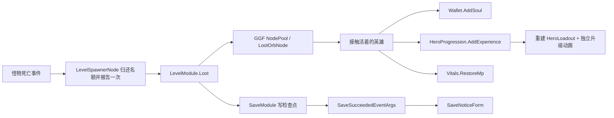

# 飞行掉落、升级与第三阶段平台（2026-10-12）

本文记录当前实现与交付证据，不覆盖集中规范。

## 从哪里阅读

Level 继续按功能分为 `Camera / Spawning / Stages / Markers / Exit`，没有汇集全部节点的 Nodes 文件夹。模块入口及其 partial 留在根目录：

| 文件 | 职责 |
| --- | --- |
| `LevelModule.cs` | 场景装配、阶段推进与出口 |
| `LevelModule.Progress.cs` | 档案快照、实际经验入账、升级、结局与检查点 |
| `LevelModule.Loot.cs` | 本关飞行球的生成、所有权、接触奖励与清理 |
| `Entity/Drops/LootHelper.cs` | 纯掉落规则；随机源从外部传入 |
| `Entity/Drops/LootOrbNode.cs` | 等待、上浮与追踪；GGF NodePool 复用 |
| `Entity/Heroes/Effects/HeroLevelUpNode.cs` | 英雄自有升级层，不占用身体/攻击播放器 |
| `Save/SaveModule.cs` | 所有档案写盘成功事实的唯一发出点 |
| `UI/SaveNoticeForm/` | 应用级、忽略鼠标的保存成功提示 |

实体不持有档案。球只报告不可变奖励，由关卡修改档案/战斗资源。死亡事件不携带怪物节点，也不跨 await 保留池化参数。清理仅回收本关拥有的球；没有全池 ReleaseAll、Autoload、测试接口或兼容 DTO。

## 数值与原版核对

核对的是造梦西游一公开加载器及其实际加载的怪物库。来源：[官方游戏容器](https://sbai.4399.com/4399swf/upload_swf/ftp5/hanbao/20110624/3/v25928.htm)、[Monster_v1.swf](https://sbai.4399.com/4399swf/upload_swf/ftp5/hanbao/20110624/3/Monster_v1.swf)。只读核对 `BaseMonster.dropAura`、`auraRed`、`auraBlue` 和 `BaseAura`；不移植 ActionScript。

| 怪物 | 固定击败经验 | 灵魂颗数 | 每颗灵魂 | 蓝球 |
| --- | ---: | --- | ---: | --- |
| 花果山猴子 | 5 | 2～4，均匀 | 1 | 12% 生成 1～3 颗，均匀 |
| 妖猴 | 6 | 2～4，均匀 | 2 | 同上 |
| 大猩猩 | 7；守关配方覆盖为 25 | 2～4，均匀 | 3 | 同上 |

原版经验是击败即增加的固定值；白球原来增加无双。本项目按用户要求，把固定总经验拆为 2～4 个随机数量的经验球（经验少于颗数时减少颗数），复用白球视觉。每颗正整数，拆分总额严格守恒。没有把原版白球误认为经验数据，也没有额外接入回血/无双掉落。

蓝球在实际接触时恢复 `max(10, floor(当前魔法上限 × 0.05))`，由 Vitals 钳制上限。灵魂/经验接触之前不入账；暂停时飞行停止；目标死亡、放弃或卸载时未领取奖励回池。已经拾取的收益参与原有关卡提交/回滚。

| 源表 | 调什么 |
| --- | --- |
| `MonsterConfig.xlsx` | `AddExp`、`SoulPerOrb`、`SoulCount`、`ManaDropChance`、`ManaCount` |
| `LevelConfig.xlsx` | 配方 `ExperienceOverride`，守关大猩猩仍为 25 |
| `DropConfig.xlsx` | 经验球颗数、回蓝比例/最低值、散布、等待、上浮、追踪速度、拾取距离 |
| `ProfileConfig.xlsx` | `StartSoul`，当前为 0 |
| `BattleConfig.xlsx` | `MonsterHealthBarFadeDuration`，当前 **4 秒**，单元格 **AE6** |

所有表改后运行 `Configs/GameConfig/gen_code_bin_to_project_lazyload.bat`（自动调用时设 `AI_MODE=1`），不手改 GameProto 或 bytes。血条继续使用原有 Quad.easeOut 淡出，持续受伤重新计时，治疗不唤起隐藏条，暂停停止计时。BOSS/守关血条仍只有名称与笔刷条，没有当前/最大生命数字。

## 平台与素材出处

三个平台的中心取自官方 GameSence 的 sprite 57 放置矩阵：

| 平台 | 世界坐标 |
| --- | --- |
| 左 | (2064.50, 369.25) |
| 中 | (2341.70, 212.80) |
| 右 | (2633.55, 368.80) |

源标记带 `isThroughWall`；形状 52 与放置缩放合成宽约 242.04、高 20。Godot 使用 Platform 层、`one_way_collision=true`。放在 `World/Platforms`，原 `World/Geometry` 的 23 个地形节点保持原样。平台图片原样复制自只读旧项目 `Art/Level/level_2/177.png`（264×76），并非截屏重绘。

升级与飞行球使用官方矢量素材渲染的原帧：

| 资源 | 官方文件与 clip | 项目资源 |
| --- | --- | --- |
| 升级 | [Role_v7.swf](https://sbai.4399.com/4399swf/upload_swf/ftp5/hanbao/20110624/3/Role_v7.swf)，sprite 240，`BaseHero.levelupmc`，28 帧 | `Sprites/Effects/level_up/level_up_frames.tres` |
| 灵魂/经验/魔法 | Monster_v1.swf，sprites 9/5/7，每个 19 帧 | `Sprites/Effects/loot/loot_frames.tres` |

重现工具：`Tools/LegacyMigration/export_official_combat_effects.py`，使用 FFDec 26.3.0；SWF 留在项目外，仅 PNG 与外置 SpriteFrames 进入游戏。解码后 SHA-256：Role `11cae2f4f4e63dbb1e7199b9d1a8ed432036138b72e2d04d1da974329133fbe7`；Monster `5bd88da4211870f2ca2354b7cec8d1790747869641c11fe553910b10fe2a264a`。

升级只在经验球实际导致等级增长后播放；进关、复用不误播。保存提示沿用原项目参考的停留 1.5 秒、上移淡出 1 秒动画，已外置为 `Sprites/UI/frontend/save_feedback.tres`。预加载建立 Notice 组监听；切换页面不会关闭它，失败不会发出成功通知。地图按钮仍展示失败颜色及重试说明。

## 存档与出口

Gameplay 标识统一为 `Soul / AddSoul / TrySpendSoul / StartSoul`，`GameData` 直接保存 Soul，没有额外包装类。格式为 **v4**，只接受当前格式，不保留 Gold 别名、旧 DTO 或转换分支。

W 若尚有掉落在飞行，会等它们真正接触后提交；不提前发放，也不漏掉卸载时的奖励。没有球在飞行时仍直接提交检查点，没有额外通关等待。

已按此前清理旧格式的授权，将本机两个 v3 档案、目录和各自备份共六文件整体移到 `C:/Users/zheliku/AppData/Roaming/Godot/app_userdata/GameZMXY/GameData_v3_backup_20261012_1550`。其中 507 经验的旧档完整保留；正式读取目录空出，下一次游戏创建 v4 档案。Validation 测试档和应用设置未移动。

## 验证

- `dotnet build Godot/GodotProject --no-restore -v quiet`：0 错误；框架过时 API 警告保留。
- `dotnet test Tests/BattleTests --no-restore -v quiet`：87/87，包含追击进入不插入零移动帧；新增用例先观察到失败，再修正 Enter 意图。
- `dotnet test Tests/ProfileTests --no-restore -v quiet`：40/40，包含真实表的数量/概率边界、经验守恒、蓝球规则、Soul 映射/回滚、拒绝包括 v3 在内的旧格式。
- `dotnet test Tests/LevelTests --no-restore -v quiet`：18/18。
- Godot `--script res://EditorScripts/validate_level_scene.gd -- --resize --fractional`：LEVEL SCENE PASS，包括三平台坐标、层与单向属性。
- `python Tools/ProjectMaintenance/validate_game_references.py --compare-staged-geometry`：293 路径、210 UID、23 原地形节点，通过。
- `-- --smoketest=ui`：headless 与 OpenGL 都 PASS；真实妖猴追击动画、三平台从下向上/落稳、飞行暂停与追踪、接触才入账、实际升级动画、蓝球回蓝/上限/复用/目标死亡取消、卸载回收、灵魂回滚及死亡写盘通过。蓝球低概率夹具只在测试中使用反射，不增加生产观测 API。
- `-- --smoketest=frontend`：OpenGL PASS；真实鼠标、手形光标、选角、地图动态命中、应用提示复用和 GGF 声音通过。
- `-- --smoketest=level`：headless 与 OpenGL 都 PASS，33 只怪物、204 经验，W 返回地图显示成功提示并重新读盘。最后 headless 实测灵魂 168（配置范围 108～216）；W 时有球在飞行，含实际拾取和写盘返回为 1499ms，OpenGL 为 1304ms。
- 原 Collection Res 生成器生成 278 项资源；Ge UI 绑定通过现有 `regenerate_ui_form.py` 生成。清理自定义 Luban 表模板中属性行末空格后重新生成，`git diff --check` 通过。没有手改生成产物。

实际 OpenGL 画面在忽略目录 `.godot/validation/{stage_3_platforms,level_up,flying_loot}.png`，菜单证据在同目录 frontend 下。

## 规范差异和剩余边界

依据第 00/10 章的功能目录及单一 owner、第 20 章的源表驱动、第 30/40 章的表现与物理边界、第 70 章的检查点与关卡事务实现。入口要求“规范与实现冲突时报告，不自行更改规范”，因此集中正文未改：20/70 章仍记 StartGold/Gold/v3；00/60/70 章部分例子仍是击败直接入账；60 章血条仍记 2 秒。这些旧描述以本轮用户要求和上述实际实现为准，等待明确要求后再同步规范。

没有未完成的本轮玩法项。框架只读边界保留：运行退出仍可能在 `DefaultWebRequestAgentHelper.Reset` 访问已释放节点；编辑器退出仍有 `ComponentInsoector._ExitTree` 释放 RefCounted 异常。它们与测试业务 PASS 分别记录，未修改 Framework/addons。
