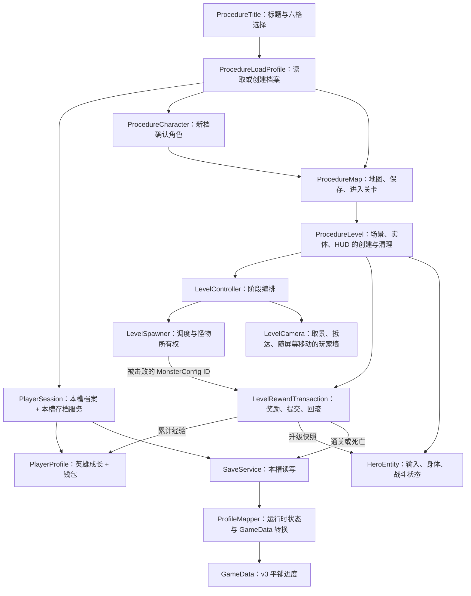

# 从一次游戏流程读懂项目

这是当前实现的阅读地图，不替代 `ProjectGuidelines/` 中的集中规范。先沿一次“读档 → 进关 → 击败 → 保存”阅读，比逐文件看完整类图更快。

## 流程和所有权

`ProcedureLevel` 拥有场景、实体、HUD、取消令牌和收益事务。`PlayerSession` 只在进入时从流程数据读取到局部变量；收益事务直接接收需要的档案、存档服务和两张配置表，不再持有整个会话或配置总表。

## 数据各自负责什么

| 类型 / 目录 | 回答的问题 | 生命周期 |
| --- | --- | --- |
| `Profile/PlayerProfile` | 这个槽拥有谁、谁出战、多少金币？ | 读档到回标题 |
| `Profile/HeroProgression` | 哪个英雄累计了多少经验、现在几级？ | 档案内；直接包含 HeroId，无 HeroRecord 包装 |
| `Profile/ExperienceCurve` | 累计经验如何换算等级和进度？ | 只读规则 |
| `Battle/Attributes/HeroBattleSnapshot` | 本次显示或升级给实体什么等级和基础属性？ | 一次注入，冻结数据 |
| `Battle/Attributes/ActorAttributes` | 基础属性叠加各来源修正后是多少？ | 实体运行时 |
| `AttributeModifier` / `AttributeSourceId` | 修正什么、加多少、结束时移除哪一组？ | 随属性来源登记与移除 |
| `Battle/Attacks/AttackInstance` | 这次出招的参数是什么、已经打中过谁？ | 一次出招；引用池 |
| `Battle/Damage/CombatStatsSnapshot` | 结算时一方的属性是什么？ | 按值冻结的公式输入 |
| `Battle/Damage/DamageResult` | 这次命中造成多少伤害、是否闪避或暴击？ | 按值返回的公式输出 |
| `Battle/Resources/` | 还剩多少生命、魔法、无双？ | 实体运行时；不写盘 |
| `Session/LevelRewardTransaction` | 本关奖励是提交还是回滚？ | 进关到结局 |
| `Save/Data/GameData` | 文件里实际保存哪些进度？ | v3 文件快照 |

攻击实例跨帧并维护命中去重；属性快照只作为公式输入；伤害结果是输出。它们有不同职责，不能合并成一个通用 Data。

未实现装备、法宝和被动，当前就不维护空的持久修正列表与来源替换链。升级直接替换基础属性，保留无双等局内来源。怪物击败通知只需要配置 ID，已删除 `MonsterDefeat`；GGF 池化事件仍负责跨模块的一次性分发。

## 建议阅读顺序

1. [GameData](../Godot/GodotProject/TheGame/GameScripts/Save/Data/GameData.cs) 和 [存档说明](../Godot/GodotProject/TheGame/GameScripts/Save/README.md)：先知道保存什么。
2. [PlayerProfile](../Godot/GodotProject/TheGame/GameScripts/Profile/PlayerProfile.cs)、[HeroProgression](../Godot/GodotProject/TheGame/GameScripts/Profile/HeroProgression.cs)：知道状态由谁维护。
3. [ProcedureLevel](../Godot/GodotProject/TheGame/MainPack/Scripts/Procedure/ProcedureLevel.cs)：看创建顺序和逆序清理。
4. [LevelController](../Godot/GodotProject/TheGame/GameScripts/Level/LevelController.cs)：顺着抵达、开战、刷怪、清波看阶段。
5. [LevelRewardTransaction](../Godot/GodotProject/TheGame/GameScripts/Session/LevelRewardTransaction.cs)：顺着击败、升级、提交、回滚看收益。
6. [ActorEntity](../Godot/GodotProject/TheGame/GameScripts/Entity/ActorEntity.cs) 的 `BeginAttack` / `ReceiveHit`，再看 `Battle/`：理解战斗数据如何流动。
7. `UI/*/*.Logic.cs`：界面订阅状态、立即刷新，关闭时退订；按钮只提交具名请求。

身体状态机和 AI 分别放在英雄/怪物目录的 `Core/` 与 `States/`；命名空间与实际目录一致。`BodyFsm` 是 C# 14 扩展块，负责物理帧调度，状态只负责决策。UI 继续使用既有生成器的 `GameLogic.UI` 契约。

## 花果山边界

首波停止点 x=1139.9，出生点 x=1256.4。官方原程序也是从右侧场外出生，不应为了让它出现在画面里改动出生坐标。原版角色的碰撞边界限制在屏幕 x=20～920，怪物巡逻会朝视野中心折返；当前实现补上了这两个分工，保留中央 ±40px 的相机死区与精确阶段抵达规则。详细证据见 [官方核对](OfficialHuaguoshan.md)。

验证与规范差异登记在 [本轮审查记录](GameplayRefactorAudit.md)。
