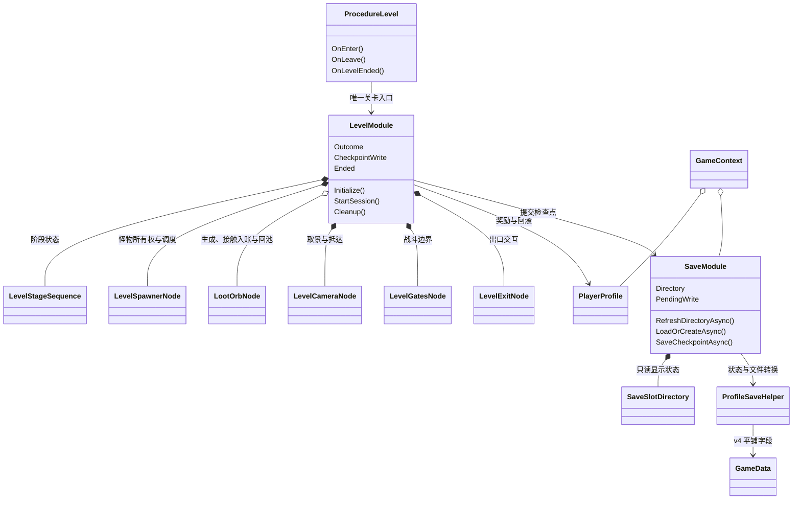
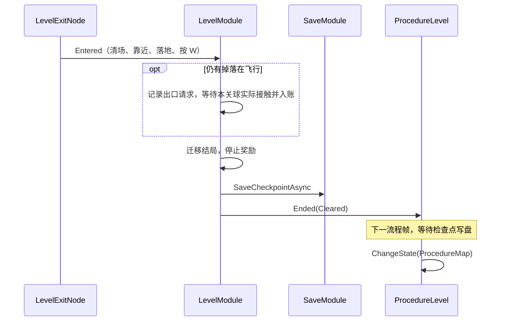

# 从模块入口读懂项目

这是当前实现的阅读地图，规范只维护在 [ProjectGuidelines](ProjectGuidelines/AGENTS.md)。先看模块职责，再沿“进关 → 击败 → 出口 → 保存”阅读。

## 流程与模块

`Launch → Update → Preload → Title → LoadProfile → 新档 Character / 已有档 Map → Level`。只有点击地图花果山才进入关卡。

| 入口 / 状态 | 负责什么 | 不属于它的职责 |
| --- | --- | --- |
| `ProcedureLevel` | 按顺序加载场景、显示英雄、打开 HUD；逆序清理；决定回地图或死亡重开 | 阶段判定、奖励和存档映射 |
| `LevelModule` | 阶段、守关对手、奖励、升级注入、结局和关内回滚 | 文件格式和文件读写 |
| `SaveModule` | 六格目录读取、读档/建档、检查点提交，维护槽位归属 | 战斗和关卡结局 |
| `GameContext` | 关联当前槽的 PlayerProfile 与 SaveModule，传给流程 | 没有转发事件或第二套关卡生命周期 |
| `PlayerProfile` | 出战英雄、英雄成长与钱包的持久状态 | 不持有实体、场景或 UI |
| `ActorEntity` / `HeroEntity` / `MonsterEntity` | 身体、输入/AI、战斗属性、生命、攻击与死亡 | 不直接改档案或读写文件 |
| GGF UI Form | 观察状态、刷新显示、提交具名点击请求 | 不切流程、不结算奖励 |

同一个模块只有一个生命周期入口。原来的 `LevelRun` 和 `LevelController` 已合并为同一 `LevelModule`；收益代码分在 `LevelModule.Progress.cs`，没有第二个运行对象。标题流程也只持有 SaveModule，目录是它拥有的显示状态。



## 目录和命名

```text
GameScripts/
  Level/
    LevelModule.cs             阶段与内部节点装配
    LevelModule.Progress.cs    同一对象的收益、检查点、回滚
    LevelModule.Loot.cs        同一对象的飞行掉落所有权与拾取
    Camera/                   相机节点与相机纯算法
    Spawning/                 刷怪节点、生成点与生成调度
    Stages/                   阶段序列、战斗区域门与特殊触发区
    Markers/                  共享空间集合基类与条目资源
    Exit/                     出口节点与交互
  Save/
    SaveModule.cs             文件操作唯一入口
    SaveModule.Directory.cs   同一对象的目录刷新
    Data/                     GameData、GameCatalogue、ProfileSaveHelper
    Slots/                    目录状态和格子摘要
  Battle/                     Attributes、Attacks、Damage、Resources
  Profile/                    PlayerProfile、HeroProgression、Wallet、ExperienceCurve
  Entity/                     共用身体、英雄、怪物、判定组件
  UI/                         每窗一个目录；Widgets 为被动控件
```

入口用 `Module`，内部 Godot 组件用 `Node`，纯方法辅助用 `Helper`，资源用 `Resource`。Entity/Form/Hud/Bar/Button 已明确表达节点种类，保持这些后缀。拥有状态的 ExperienceCurve、LevelStageSequence 等使用领域名称。细则见 [命名规范](ProjectGuidelines/10-CSharp.md)。

内部目录按功能分类，节点、辅助方法和规则与所属功能放在一起，通过类型后缀区分。命名空间按业务模块稳定：Level 内部统一 `GameLogic.Level`；身体、英雄、怪物分别使用 `GameLogic.Body`、`GameLogic.Heroes`、`GameLogic.Monsters`，Core/States 只作目录分组；GGF 窗口沿用 `GameLogic.UI`。生成器与框架固定的名称保留。

## 沿一次操作阅读

1. [GameData](../Godot/GodotProject/TheGame/GameScripts/Save/Data/GameData.cs)：保存出战英雄、拥有英雄的 ID/累计经验、灵魂；等级与战斗属性重算。生命、魔法、无双、位置、波次不写盘。
2. [SaveModule](../Godot/GodotProject/TheGame/GameScripts/Save/SaveModule.cs) 与 [存档说明](../Godot/GodotProject/TheGame/GameScripts/Save/README.md)：六格 → 读档/建档 → GameContext → 检查点。
3. [ProcedureLevel](../Godot/GodotProject/TheGame/MainPack/Scripts/Procedure/ProcedureLevel.cs)：加载场景、注入英雄与档案、开始模块、打开 HUD；失败和退出走同一清理边界。
4. [LevelModule](../Godot/GodotProject/TheGame/GameScripts/Level/LevelModule.cs)：相机抵达 → 开战 → 调度清波 → 下一阶段或开放出口。
5. [LevelModule.Progress](../Godot/GodotProject/TheGame/GameScripts/Level/LevelModule.Progress.cs)：飞行经验球接触后进入档案；升级重建 HeroLoadout 并播放独立动画；通关/死亡提交，放弃恢复进关快照。
6. [ActorEntity](../Godot/GodotProject/TheGame/GameScripts/Entity/ActorEntity.cs) 与 [DamageHelper](../Godot/GodotProject/TheGame/GameScripts/Battle/Damage/DamageHelper.cs)：攻击包 → 属性快照 → 伤害结果 → 生命与死亡。身体调度由 C# 14 BodyFsmHelper 扩展块执行。
7. [BattleHud.Logic](../Godot/GodotProject/TheGame/GameScripts/UI/BattleHud/BattleHud.Logic.cs)：订阅真实状态并立即刷新；关闭时退订；守关条只接收数值。

## 出口与检查点



只跨两层观察边界：出口节点 → 关卡模块 → 流程；没有 Completed → OnCompleted → Ended 转发对象。原来的 ClearRestartDelay=3 秒已从源表删除，通关不附加固定等待；仍在飞行的球实际拾取完毕后提交，无球时直接提交。死亡仍保留配置的 2.5 秒。测试在隔离存档目录测量 W 到地图实际可见的耗时，并重新读盘验证 204 经验及拾取的灵魂。

## 战斗数据与表现

HeroLoadout 是英雄显示/升级的冻结输入；CombatantStats 是出招/受击时的最终属性快照；AttackInstance 跨帧维护命中去重；DamageResult 是公式输出。它们的方向和生命周期不同。

怪物基础配置每种一条，刷怪配方提供生命、物防、攻击倍率和经验覆盖。花果山大猩猩使用基础生命 300 × 3，经验覆盖 25；池复用回到基础值。

小怪受伤后以不透明显示，按配置的 4 秒 Quad.easeOut 淡出后隐藏；继续受伤重新计时，治疗不唤起已隐藏血条，暂停停止计时。守关 HUD 按参考图采用左侧白字黑边华康海报体和右侧原笔刷血条，无进场弹窗，也不显示当前/最大生命数字。

官方关卡来源、项目取景选择和历史核对见 [OfficialHuaguoshan](OfficialHuaguoshan.md)，前一轮的实现与验证记录见 [HuaguoshanEncounter](HuaguoshanEncounter.md)。前轮模块整理见 [ModuleRefactor](ModuleRefactor.md)，当前掉落、升级与平台交付见 [CombatFeedback](CombatFeedback.md)。
