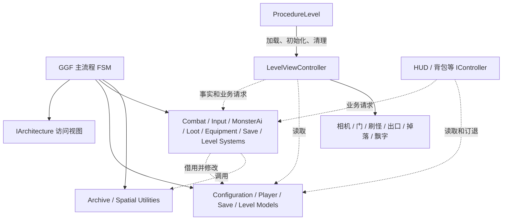
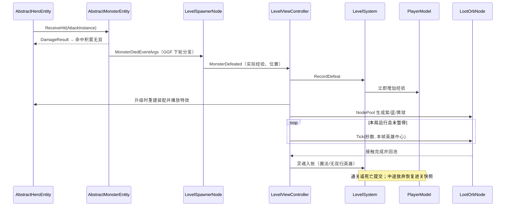

# 项目导览

唯一规范是 [ProjectGuidelines/AGENTS.md](ProjectGuidelines/AGENTS.md)。本页说明当前实现；官方数值看 [OfficialReference](OfficialReference.md)，素材出处看 [LegacyAssetMap](LegacyAssetMap.md)，验证看 [Validation](Validation.md)。

## 启动与返回

`Launch → Update → Prepare → Preload → Title（开始、六格存档）→ LoadGame → 新档 Character / 已有档 Map → 花果山 → Level`。

当前开放悟空和花果山。未解锁角色无交互；悬停可选角色才显示颜色与 1P。关卡清场后落地按 W 使用出口，待飞行掉落拾取后结算；死亡保留收益，中途放弃回滚。返回地图或重试前等待检查点写盘。

## Architecture 与职责

参考 [QFramework 源码](https://github.com/liangxiegame/QFramework/blob/master/QFramework.cs) 的归属、访问能力及 Model/System 分工，项目统一使用 System 命名业务系统。对象仍只存放在 **GGF 主流程 FSM 的原生数据区**，Architecture 是访问视图，没有第二套 IOC 容器或全局架构单例。

| 角色 | 职责 | 可以访问 |
| --- | --- | --- |
| Model | 拥有状态或共享只读定义，维护自身不变量 | Utility |
| System | 查询 Model 并执行业务规则，协调多个状态源 | Model、System、Utility |
| Controller | 节点、输入、交互、订退、动画与显示；提交业务请求 | Model、System、Utility |
| Utility | 平台适配与通用数学；不处理游戏业务 | 无 Architecture |
| Procedure | 创建和注册作用域、异步加载、导航、逆序清理 | 明确的流程 FSM |

**Architecture 分别拥有 Model 和 System；System 借用 Model。** 例如 LevelSystem 不拥有 LevelModel，也不持有英雄或相机；PlayerModel 自己拥有成长、钱包、背包和穿戴。实体自己的生命、输入、冷却仍由实体拥有，每只怪物各有独立状态，不注册成全局 Model。

[ArchitectureContracts.cs](../Godot/GodotProject/TheGame/GameScripts/Architecture/ArchitectureContracts.cs) 集中 IModel、ISystem、IUtility、IController 和访问能力接口。AbstractModel 与 AbstractSystem 分别实现绑定和同步生命周期，没有 AbstractArchitectureMember；Utility 不绑定架构。窗口和节点实现 IController，保留 Godot/GGF 的继承链，通过 C# 14 扩展调用 `this.GetModel<T>() / GetSystem<T>() / GetUtility<T>()`。

三个 Get 方法都返回本 FSM 注册的同一对象，未注册时返回 `null`，需要可选依赖时直接判空。架构尚未初始化、已经销毁或 FSM 已被池化复用时仍报告生命周期错误，避免旧对象访问新游戏的数据。

## 所有者与初始化位置

| 作用域 | 创建和注册位置 | 独立注册的对象 | 结束边界 |
| --- | --- | --- | --- |
| 应用 | ProcedurePrepare.OnEnter | ConfigurationModel、SaveModel；ConfigurationSystem、CombatSystem、InputSystem、MonsterAiSystem、LootSystem、SaveSystem；ArchiveUtility、SpatialUtility | 主流程 FSM 销毁；GGF 管理平台服务 |
| 档案 | ProcedureLoadGame，读档完整成功后发布 | PlayerModel、EquipmentSystem | 返回标题先等待写盘、关闭窗口，再移除系统和模型 |
| 本局 | ProcedureLevel，加载场景后装配 | LevelModel、LevelSystem | 关窗 → ViewController.Cleanup → RemoveSystem → RemoveModel → 隐藏英雄 → 卸载场景 |
| 表现 | GF.Scene / GF.Entity / GF.UI / NodePool | LevelViewController、实体、窗口与池节点 | 场景卸载、Hide、Close 或归池 |

数据模型只保留四类，各自有明确的作用域：

| 模型 | 拥有的数据 | 不持有的内容 |
| --- | --- | --- |
| ConfigurationModel | 同一份 Tables 的查询索引、共享 ExperienceCurve、按角色/怪物类型缓存的 HeroBodyParams / MonsterBodyParams | 节点、构建委托、逐实体的冷却或跳数 |
| PlayerModel | 当前槽的成长、钱包、背包和各英雄穿戴；存档映射及回滚维护这些子对象身份 | 文件 I/O、当前生命和位置 |
| SaveModel | 当前文件编号 ActiveSlotUnitId、六格摘要、读取阶段、错误及 Changed | 玩家成长、读写任务 |
| LevelModel | 本关阶段、时间、统计、结局、成绩及进关快照 | 场景节点、共享配置副本 |

ConfigurationSystem 注册时集中校验跨表约束。身体参数首次加载同类场景时由实体读取动画后交给 ConfigurationModel，后续池实例借用同一份只读参数。SaveSystem 负责读写与任务串行；选择新槽时更新 SaveModel 的文件编号，回标题保留应用模型。SoundExtensions 是 GGF SoundComponent 的 C# 14 扩展，调用 `GF.Sound.PlayConfigured(...)` 直接按配置播放，不另注册 SoundSystem 或 AudioUtility。

GGF 同步 RegisterModel/RegisterSystem 调用 Init，Remove 调用 Deinit。注册按“工具 → 模型 → 依赖它们的系统”，移除逆序；异步加载、写盘等待与节点清理由流程显式安排。FSM 池化包装由 GGF 回收，Architecture 拒绝销毁或池复用后的旧访问视图；重复注册和跨架构绑定立即失败，未注册的 Get 返回 null。Prepare.OnEnter 直接建立资源组、恢复音量并注册工具、Model、System；F6 TestArena 在测试入口自行装配临时 FSM，不为测试增加正式注册包装。Startup 目录已移除，Preload.OnEnter 直接设置语言并加载常驻界面，LoadGame 负责所选存档和档案作用域。Title、Character、Map 各自管理窗口、音乐、取消和导航，不再继承菜单流程基类。

第 00/10/70 章仍保留 Module、Startup 和菜单基类等旧约定，与用户后续采用 System、IController 及准备流程的要求有差异，当前实现按最新指令执行，未改写这些章节。第 50 章只登记了本轮必要的 Prepare/LoadGame 流程注册清单变更；其他框架文件仍只读。

只使用一次的初始化或纯转发步骤直接放在所属生命周期、事件处理处；事件订阅所需的具名回调和实际复用的业务逻辑保留方法，不按行数机械合并。



## 关卡和界面怎样协作

LevelModel 保存阶段、计时、统计、结局、成绩和进关回滚副本。LevelSystem 处理阶段迁移、奖励、装备交易、检查点与回滚。LevelViewController 接收相机抵达、清波、英雄死亡等事实，提交给系统，再驱动节点；守关怪物节点与其展示事件归控制器。

HUD 和背包通过 IController 直接获取 PlayerModel、LevelModel、ConfigurationModel；BattleHudData 只保留英雄与场景控制器，InventoryFormData 只保留英雄。SaveForm、SettingsForm、SkillForm 不需要打开 Data：目录、钱包、出战角色都从 Model 读取，设置用 `GetModel<LevelModel>()` 后判空区分标题与关卡作用域。技能页和背包子面板同样实现 IController，自行读取共享状态和配置；装备格、资源条等通用控件仍接收具体展示输入。

窗口在 OnOpen 用 `+=` 订阅并立即刷新，在 OnClose 用对应的 `-=` 退订，并恢复自身发起的暂停。流程必须先关闭窗口，再移除 Model 或隐藏实体；窗口打开期间 Model 及其订阅的子对象身份保持不变。交互通过 `GF.UI.HasUIForm(SerialId)` 判断当前是否打开，不另存 m_IsOpen。GGF 在 OnOpen 前登记、OnClose 前移除界面，因此关闭后到回池前的迟到信号也会被挡住。OnRecycle 清除框架编号和表现数据，不再查询已移除的共享 Model；HUD/背包必要的 Data 清理可重复执行。穿戴和出售仍提交给 LevelSystem。

```csharp
// ProcedureLevel：Model 和 System 分别注册，场景只绑定访问入口。
procedureOwner.RegisterModel(new LevelModel());
procedureOwner.RegisterSystem(new LevelSystem(procedureOwner.GetArchitecture()));
levelViewController.Initialize(procedureOwner.GetArchitecture());

// InventoryForm : IController：提交业务请求。
this.GetSystem<LevelSystem>().TryEquip(instanceId);

// System：借用同一份状态；不缓存配置引用字段。
var playerModel = this.GetModel<PlayerModel>();
var tables = this.GetModel<ConfigurationModel>().Tables;
```

Title、Character、Map、Level 是同一流程 FSM 的状态。切状态不会清空数据：回标题移除档案，离关移除本局，应用模型和业务系统继续存在。异步等待前捕获本周期状态源与取消令牌；等待后不能用新档案替代旧操作。

## 配置、运行时和快照

- 地面物品只保留 PickupId 与实际装备，飞行球保留已经抽定的奖励；DropConfig、恢复品与图标定义按主键查询。装备格不缓存 EquipmentConfig。
- 怪物 AI 直接读取 MonsterConfig，删除 MonsterAiParams 及三个重复构建方法。招式列表由 ConfigurationModel 排序一次、同类实体共用；HeroBodyParams / MonsterBodyParams 由 ConfigurationModel 共享，集合只读。英雄各有 ActionData（HeroActionData），怪物各有 AiData（MonsterAiData）；目标节点和状态机仍归实体。
- CombatSystem 负责伤害、击退和命中无双；LootSystem 负责掉落抽取与回蓝规则。DamageResult / LootReward 只表达结果。SpatialUtility 与 SpatialExtensions 处理空间计算；结果和配置类型不再挂这些通用计算。
- 保留时间边界快照：出招属性避免招式中途换装改变已发攻击；HeroLoadout 冻结本次装配；进关 GameData 用于放弃回滚；LevelResult 固定结算成绩。它们与共享配置引用有不同职责。

模型引用统一用 `PlayerModel / playerModel`、`LevelModel / levelModel`、`SaveModel / saveModel` 命名，不再把整个模型称为 Profile、Level 或 Directory。`EquipmentSystem.CreateLoadout()` 从当前注册的 PlayerModel 生成 HeroLoadout；穿戴、卸下和出售也由系统内部读取模型。HeroLoadout 只携带身份、等级、基础属性与不可变装备实例，不是 Model，也不保存 PlayerModel 引用。实体接收后更新自己的属性与外观；进关、升级和换装共用此路径。独立测试场地用显式成长记录构建自己的快照，不注册正式玩家档案。

节点引用按职责处理：GroundItemNode 的 PickupArea 检测实际重叠身体，LevelExitNode 与 LevelTriggersNode 同样从局部碰撞识别存活英雄，均不缓存外部英雄。接触者短暂交给 LevelViewController 校验本会话身份，再交易或推进流程；拒绝不会消耗物品或触发区。满包时保持检测，腾出空位后重试。监测启停使用 deferred，查询只在监测生效后进行；真实重叠按物理步更新，见 [Godot Area2D](https://docs.godotengine.org/en/stable/classes/class_area2d.html#class-area2d-method-get-overlapping-bodies)。

飞行球不持有英雄或目标代理：LevelViewController 每帧把当前英雄受击盒中心传入 Tick，球仅保留本次奖励与运动状态；暂停不移动或结算，死亡/放弃/卸载由关卡统一回收。相机跟随、怪物目标记忆和 HUD 观察订阅仍有明确的借用引用，分别在 StopFollowing、OnHide 和窗口解绑时清理。HurtBox 的 Owner 属于同一个实体的装配关系；刷怪器的生成点索引与巡逻锚点是场景协作依赖。System 和 Model 不持有场景节点。

`PlayerModel.CaptureSaveData → GameData → SaveSystem → ArchiveUtility → GGF`。FromSaveData 是建立新档案的工厂，RestoreCheckpoint 原地恢复已有子状态，保留 UI 订阅身份；这些转换与状态放在同一 PlayerModel.cs，不再拆 Persistence partial。模型工厂、池化 Create、结果构造方法仍保留，游戏公式归业务系统。

当前 v6 保存英雄累计经验、灵魂、装备实例实际属性和穿戴引用；生命、魔法、无双、位置、波次不保存。详细字段见 [存档说明](../Godot/GodotProject/TheGame/GameScripts/Save/README.md)。状态变化不自动写盘；通关和死亡提交，放弃回滚。

## 按顺序阅读

| 入口 | 要看清的问题 |
| --- | --- |
| [ProcedurePrepare](../Godot/GodotProject/TheGame/MainPack/Scripts/Procedure/ProcedurePrepare.cs) → [FsmArchitectureExtensions](../Godot/GodotProject/TheGame/GameScripts/Architecture/FsmArchitectureExtensions.cs) | 注册顺序和原生存储 |
| [ProcedureLoadGame](../Godot/GodotProject/TheGame/MainPack/Scripts/Procedure/ProcedureLoadGame.cs) → [PlayerModel](../Godot/GodotProject/TheGame/GameScripts/Profile/PlayerModel.cs) | 档案所有权和存档转换 |
| [ProcedureLevel](../Godot/GodotProject/TheGame/MainPack/Scripts/Procedure/ProcedureLevel.cs) → [LevelModel](../Godot/GodotProject/TheGame/GameScripts/Level/LevelModel.cs) / [LevelSystem](../Godot/GodotProject/TheGame/GameScripts/Level/LevelSystem.cs) / [LevelViewController](../Godot/GodotProject/TheGame/GameScripts/Level/LevelViewController.cs) | 本局状态、业务和节点分别归谁 |
| [EquipmentSystem](../Godot/GodotProject/TheGame/GameScripts/Equipment/EquipmentSystem.cs) → [InventoryForm.Logic](../Godot/GodotProject/TheGame/GameScripts/UI/InventoryForm/InventoryForm.Logic.cs) | 装备交易和观察刷新 |
| [ConfigurationModel](../Godot/GodotProject/TheGame/GameScripts/Config/ConfigurationModel.cs) / [ConfigurationSystem](../Godot/GodotProject/TheGame/GameScripts/Config/ConfigurationSystem.cs) | 只读目录和启动校验 |

当前实现以用户最新指令为准：第 00 章禁止 Architecture/Model 和 GameContext 旧约定、第 10 章旧 Helper 与入口命名约定、第 70 章旧版本与装备未保存描述均与当前实现不同。规范正文未自行改写；本页记录实际代码。

## 界面、动作与资源

背包场景按 `Window / CharacterPanel（Identity、EquipmentSlots、Attributes、Experience）/ BagPanel（Tabs、m_BagGrid、Footer）` 分组；出售确认独立为 `m_SaleConfirmation / Center / Panel / Content（标题、摘要、说明、Actions）`，全屏遮罩阻挡背后点击。每项属性有独立的 Caption 与数值 Label。外置 `hero_preview.tscn` 和动画库只含身体、武器与光效表现，不创建第二个战斗实体。

根窗口负责生命周期、订退、暂停和业务请求。只在面板具有完整职责，或控件确实复用、包含独立交互时拆脚本；Footer、Column、行容器等布局分组不需要脚本。面板不拥有档案或执行交易。

| 窗口 | 根绑定数 | 子组件职责 |
| --- | --- | --- |
| InventoryForm | 5 | Character 统一显示身份、穿戴、属性和经验；Bag 统一管理分类、25 格、分页、灵魂和品质选项；SaleConfirmation 负责一次性出售确认；另绑定 Close、Actions |
| SaveForm | 3 | Close、Status、Slots；表单直接收集六格并更新姓名、日期、提示和交互，不设 Grid/Button 脚本 |
| BattleHud | 5（原 12） | Status、Menu、Go、EncounterHealthBar、MusouActivation；Status 显示生命/魔法/经验/等级，Menu 管无双满值提示及三个菜单按钮 |
| SkillForm | 8 | 表单直接处理返回、分类和灵魂，只展示出战角色并禁用其他角色；ActivePage、PassivePage 分别刷新整页，行及行组只负责布局 |

组件脚本按用途归入窗口的 `Components/`，不再设 `GameScripts/UI/Widgets/` 汇总目录：背包的装备格、tooltip、操作菜单、品质格式和预览归 InventoryForm；资源条、守关条和无双开启表现归 BattleHud；地图地点命中归 MapForm。目录移动保留 UID 与稳定命名空间。场景资源仍在既有 `UIs/Widgets/`，不改变资源键；共用 Theme/StyleBox 仍在 `MainPack/Themes/`。其余 Start、Character、Map、Settings、Settlement、SaveNotice 表单没有纯布局包装脚本。第 40 章的 HUD 根绑定旧示例与当前组件装配有差异，按用户当前要求执行，未修改规范正文。

预览采用独立场景组合，动画保存为外置资源；参考 Godot 官方的 [场景组织](https://docs.godotengine.org/en/stable/tutorials/best_practices/scene_organization.html) 与 [Resources](https://docs.godotengine.org/en/stable/tutorials/scripting/resources.html)。数值配置和档案所有权仍遵循本项目的 Luban 与 PlayerModel 约定。

技能入口走 `BattleHud → SkillsRequestedEventArgs → ProcedureLevel → SkillForm`，与背包、设置互斥。场景按 `Content / Header、m_ActivePage、m_PassivePage、Footer` 分组；十行主动和五行被动直接写在 `skill_form.tscn`，不使用行子场景或行脚本。每行是 GridContainer：主动五列为 Name / IconCell / Soul / Key / DescriptionCell，被动六列为 Name / Level / CurrentEffect / NextEffect / Upgrade / Soul。两个页脚本在初始化时收集本页固定节点，绑定数据时统一刷新；窗口通过 Model 读取目录、钱包与关卡。返回、Esc 和关卡结束均对称解除暂停及订阅。

在编辑器展开 `Content/m_ActivePage/m_WukongRows/Skill1..5`、`m_TangsengRows/Skill1..5` 或 `Content/m_PassivePage/m_PassiveRows/Passive1..5`，即可直接修改文本与布局。各列的 Custom Minimum Size X 决定列宽，IconCell/Icon 的偏移控制图标，DescriptionCell 的 Margin 控制说明留白；各行在父 Control 中保留可微调的 Y 位置。调整整列时保持该页五行与 Headers 的列宽一致。切换页面的 Visible 可预览唐僧或被动页。场景预填名称、费用、按键、说明及图标，运行时 Refresh 总是以正式表覆盖这些展示内容。

战斗 `idle1` 和背包预览 `idle` 共享原版 100 帧、24 fps 的完整待机循环，立棍张望由动画时间轴负责。地面装备和恢复品接触时入账，随后用 `Entitys/Animations/ground_item_pickup_library.tres` 在 0.8 秒内上移 100px 并淡出；关卡保留节点所有权直到动画结束。

悟空五项技能动画挂在实体 AnimationPlayer 的 `skills` 库，源帧按 24 fps 换算为秒；仍共用身体/武器两张可独立替换的图层。大光效位于 `Sprites/Effects/wukong/skills/`，火魔斩分段特效场景在 `Entitys/Effects/Skills/`，外置库在 `Entitys/Animations/Skills/`。原版七段声音在 `SoundConfig` 中按 SoundId 7..13 登记到 GGF SFX。技能数据按职责分为：

| 源表 | 内容 |
| --- | --- |
| SkillConfig / PassiveConfig | 两角色十项主动及共用被动五级目录、费用、说明和图标 |
| SkillHitConfig | 两角色 11 个伤害阶段、舍入位置、击退与源命中参数 |
| SkillActionConfig | 悟空五项动作、起手音、无敌秒数、普攻取消阈值及二段跳消耗 |
| SkillEffectConfig | 五个独立特效的资源、朝向、缩放及声音 |
| SkillTimelineConfig | 悟空 47 条秒制位移、攻击编号、目标分支、落地及结束事件；特效事件使用所属特效的局部时间 |

`ConfigurationSystem` 在启动期校验所有外键、参数与局部时间顺序。火魔斩的目标命中/缺失、落地暂停/恢复和九连编号均已配置；没有添加学习记录、扣费或施放入口。美术原点与复现流程见 [LegacyAssetMap](LegacyAssetMap.md#悟空造一技能动作与声音)，原版规则见 [OfficialReference](OfficialReference.md#造一技能准备)。

英雄输入按 `AbstractHeroEntity → InputSystem → HeroActionData → Ground/Air/Attack` 阅读。InputSystem 集中动作名称、引擎采样、方向双击、组合闩锁和普攻连段规则；HeroActionData 由每个英雄拥有，保存输入事实、游戏时钟、已用跳数、连段和冷却。JumpCount 是运行状态，不放入同类共享的 HeroBodyParams。原 HeroInput / HeroAttackSequence 已合并，不新增逐英雄 System。

Ground/Air 提交输入请求并决定是否进入 Attack；Attack 管理当前动画、移动与收招。普攻仍不排队：过早输入丢弃，有效输入立即换段；参数在 HeroConfig，具体源规则见 [官方输入依据](OfficialReference.md#普攻输入与移动2026-10-14)。调用方只执行 `InputSystem.Sample(this, delta)`；系统内部读取默认 Godot 输入源、英雄独占的 ActionData 与共享 Params，不再外传十几个按键布尔值。引擎采样与规则合在 InputSystem.cs；确需替代控制源时通过同文件的 IInputSource 提供按住/按下/松开事实，使用同一套采样与组合规则。

怪物 AI 按 `AbstractMonsterEntity → MonsterAiPreset / MonsterAiSystem → MonsterAiData / AI 状态` 阅读。[MonsterAiPreset](../Godot/GodotProject/TheGame/GameScripts/Entity/Monsters/AI/MonsterAiPreset.cs) 是状态工厂集合与入口类型的只读配方，包含无目标和交战入口，不是枚举。预设每次创建独立状态，并在建 FSM 前检查重复类型、缺少入口、受控或死亡状态。MonsterAiSystem 集中范围检查、加权选招及冷却规则，MonsterBodyParams.Attacks 保存同类共享的 MonsterAttackParams；每只怪物的剩余冷却、移动意图和待提交攻击放在自己的 MonsterAiData。

| AI 预设 | 无目标 | 有目标 |
| --- | --- | --- |
| Patrol | 巡逻、随机停留 | 追击、站定攻击或在平台下踱步 |
| Guard | 原地等待 | 原地转向，仅攻击进入范围的目标 |
| Pursuer | 原地等待 | 追击、站定攻击或在平台下踱步 |

当前猴子、妖猴、大猩猩明确选择 Patrol 集合，保持原有行为。AI 根目录放预设、系统、数据和契约，States 按 Patrol / Combat / Common 分组。具体怪物必须声明 AiPreset；未来 Boss 可以用自己的状态工厂集合构造预设，指定入口，不必修改系统分支或新增枚举值。特殊初始状态、招式和请求门槛仍可覆写 InitialAiStateType、BuildAttackParams 和 TryRequestAttack。第 30 章的 CreateAiStates 旧接口描述与本次用户要求有差异，当前以状态集合预设为准，规范正文未改动。

怪物的 `Move → Attack → Recovery` 切换通过 GGF 的 `SetData/GetData/RemoveData` 传递招式下标和收招时长；目标状态在 Enter 时消费参数并自行初始化。状态之间不直接调用 `Arm` 或改写彼此字段。

共享英雄状态按各英雄的参数读取普攻段数、动画名、冷却与空中段号；已用一段、三段配置在 60/120Hz 验证循环和空中出招。悟空的第三段下劈由 `WukongEntity.BuildBodyParams` 指定。新增角色仍由具体实体提供状态集，唐僧的弹道、专属技能及不同攻击移动规则需要各自实现。

当前怪物支持配置多招、独立冷却、选招优先级与收招硬直。飞行行为还有明确限制：`AbstractMonsterEntity` 接受攻击请求和 `MonsterMoveState` 消费请求都要求落地；实体已提供 TryRequestAttack 覆写点；飞行怪还需配套自己的身体状态消费规则。这里与第 30 章“新增飞行行为不修改基类”的目标仍有差距，规范正文保持原样。

背包显示悟空、唐僧的粗糙/普通装备共八种；详情显示实例的具名实际属性。点击格子打开装备、赠送、出售菜单，单人赠送禁用，异角色不能穿戴。武器与防具独立换装；替换时旧装备回包，满包不能卸下，换装不补血。售价来自装备表（粗糙 10、普通 20 灵魂）。C 对应 inventory_toggle 输入动作，打开暂停、关闭恢复；分类可切换，装备 75 格分三页，其余分类尚无物品内容；底部两行分别放灵魂/一键出售、上一页/页数/下一页，出售向上展开各品质，选择后确认件数和收益，再提交整包交易，排除穿戴物。数值沿用造梦一，提示及操作菜单按造梦三公开原资源实现。

人物穿戴槽的“武器／防具”字样来自底图。两槽各用独立且随场景实例化的 `equipment_slot_background.gdshader` 材质，EquipmentCell.Bind 在已有装备时开启 occupied；shader 取原图无字内侧列的同一行颜色清除题签，保留渐变和边框。卸下恢复原图，透明装备图标不改，背包格不使用该材质，也不新增装备表路径。

一键出售、品质上拉菜单和出售确认/取消按钮共用 `MainPack/Themes/brown_gold_theme.tres`，场景不再内嵌主题与 StyleBox。`Themes/Styles/` 下的 `brown_gold_button.tres` 使用原版棕金渐变底图；`brown_gold_button_active.tres` 保留截图中的原深棕纯色，供悬停/按下/禁用共用；`gold_focus_border.tres` 只画焦点边框。品质菜单使用 `brown_popup_panel.tres` 的深棕底和浅金文字；确认面板使用独立的 `brown_dialog_panel.tres`。其他窗口可在根 Control 的 Theme 中引用该主题，或在 Theme Overrides 中单独引用所需 StyleBox。

StyleBox 定义背景、边框、圆角和内容留白；Theme 按控件类型和状态引用 StyleBox，并配置字体、字号和颜色。比如 `Button/styles/normal` 指向常态背景，`Button/styles/hover` 与 `pressed` 指向交互背景。根 Control 的 Theme 供后代控件继承；某个控件的 Theme Overrides 优先于共享主题，确认框的 PanelContainer 就直接覆盖 `Styles/panel`。普通 Button 使用这些状态样式；TextureButton 的背景来自其各状态纹理。

装备 tooltip 沿用 Godot 的悬停、定位和销毁机制。`EquipmentCell.Bind` 设置 TooltipText；Godot 调用其 `_MakeCustomTooltip` 时，实例化导出字段 `m_TooltipScene` 指向的 `UIs/Widgets/equipment_tooltip.tscn`，注入实际装备属性并返回该 Control。面板按 `Content/Header（名称、品质、类型）/ Attributes（动态属性）/ Footer（说明、价格）` 排列；编辑这个场景即可调整内容布局。格子的局部 `tooltip_theme` 将 `TooltipPanel/styles/panel` 设为 StyleBoxEmpty，消除 Godot 外壳的背景和留白，实际底板由返回的 EquipmentTooltip 自己绘制；这两个资源均有用途。悬停延迟在项目设置 `gui/timers/tooltip_delay_sec`，当前为 0 秒。

结算展示实际游玩秒数（不含暂停）、剩余生命比例、击败数和发放经验。连击与评分尚未实现，因此未显示虚构成绩。按本次用户要求替换第 60 章旧的自动重开/直接回地图行为，并将装配工厂从 HeroLoadout.Create 移到 EquipmentSystem.CreateLoadout，HeroLoadout 保留为不可变输入；规范正文的旧描述保留待用户同步。

## 追一次击杀



跨模块的一次性结果用 GF.Event，状态变化用 Changed，所属模块协作用直接调用。池化事件不跨 await 保存；测试读取 IFsm、节点或反射，不加生产观测接口。

## 文件放哪里

| 功能 | 目录（相对 GameScripts） |
| --- | --- |
| 属性、资源、攻击与伤害规则 | Battle/{Attributes,Resources,Attacks,Damage} |
| 档案成长与钱包 | Profile |
| 保存入口、DTO、目录显示 | Save 根目录、Data、Slots |
| 英雄/怪物与身体/AI | Entity/{Heroes,Monsters,Body}；输入系统与逐英雄动作数据在 Input |
| 关卡入口 | Level/LevelSystem*.cs |
| 关卡内部功能 | Level/{Camera,Spawning,Stages,Markers,Exit}，详见 [Level/README](../Godot/GodotProject/TheGame/GameScripts/Level/README.md) |
| 窗口、控件 | UI 下每窗一目录；所属控件放该窗口的 Components |
| 世界飘字 | FloatingText；伤害/闪避、生命/魔法恢复样式，池场景位于 Entitys/Effects |
| 配置输入 / 生成物 | Configs/GameConfig/Datas/*.xlsx / GameProto 和 DataTables |

System 是业务规则入口，Model 拥有作用域数据，Controller 拥有节点，Extensions 是无状态适配扩展，Resource 是资源。按功能聚合，不把所有节点集中到 Nodes。身体状态表达动作与打断；BodyFsmExtensions 的 C# 14 扩展成员 `fsm.Tick(dt)` 负责物理调度。

## 常改位置

- 无双数值：BattleConfig.xlsx 的 Ws 字段，含义与官方依据集中在 OfficialReference；角色参数不被开启/结束反复改写。
- 满值提示：`Sprites/UI/hud/hud_ws_full_frames.tres`；圆形范围在 BattleHud 的 m_WsMax 材质参数中改。
- 开启大立绘：`Sprites/UI/hud/musou_activation/musou_activation_frames.tres`，独立于满值闪烁。
- BOSS 条：`UIs/Widgets/encounter_health_bar.tscn`；姓名和笔刷条构成顶部组件，无生命数字。
- 地图悬停：LocationGlow.Scale 调尺寸，AnimationPlayer.SpeedScale 调速度；命中跟随可见轮廓。
- 新持久字段：领域状态 → GameData → PlayerModel 双向映射/回滚 → 格式版本与验证。
- 悟空动作：先看 [官方五段攻击](OfficialReference.md#悟空五段普攻)，再看 [独立图集及原点](LegacyAssetMap.md#悟空独立身体与武器)；AnimationLibrary 管帧/特效/判定，AttackConfig 管威力/击退/声音，身体状态只驱动动作。

在 Godot 对 `TheGame/Scenes/TestArena.tscn` 按 F6 可观察战斗，它只创建内存档案。正式流程断点从 ProcedureLevel、OnHitLanded、OnMonsterDefeated、AddExperience、LevelSystem.Complete 开始。后续系统落位见规范第 60 章。

## 地面物品与地图提示

装备在死亡时生成唯一实例并抽属性；`LootSystem.RollGround` 只选择定义，`LevelViewController.Loot` 借助 GGF 节点池创建和拥有 `GroundItemNode`。物品受重力落地，接触后才恢复或入包，暂停时不计过期，10 秒未领取回收。地面只显示官方掉落图，不显示名称；背包使用另一套原版图标。满包不销毁、不重抽；出口只等飞行球，不等待未拾取的地面物品。

当前保存格式 v6：GameData 平铺英雄经验、灵魂、装备实例及具名属性；Heroes 中以实例 Guid 引用穿戴物。PlayerModel.Inventory 只含未穿戴物，HeroEquipment 保存穿戴；HeroLoadout 将基础属性和当前两件装备冻结后交给实体。旧格式不做运行时兼容。已按用户授权备份原 v4 开发档，再一次性转存累计经验 1020 和灵魂 835；原件保留在 GameData.backup-before-v6-20261013-025550，正式主档与备份均经 v6 读取验证。第 20/30/50/60/70 章旧名称与版本尚未同步，本轮只按用户明确要求补充第 40 章美术定位规则。

地图打开和鼠标离开后播放外置 `location/current` 边缘闪烁，悬停播放 `location/hover`；关闭时 RESET 并停止，复用重新启动。当前只有花果山开放，因此最新提示就是花果山；多关解锁进度尚未实现，不新增虚构进度字段。用户当前指令覆盖第 40 章旧的离开即停止提示描述；规范正文未自行修改。

恢复品和蓝球实际领取后，调用本场 `FloatingTextPresenter.ShowRecovery(position, amount, RecoveryKind.Health/Mana)`：生命数字绿色，魔法数字蓝色；显示配置恢复量（即使已达上限），一秒上移 75px，暂停停止。模块只显示反馈，实际恢复仍由拾取业务结算；后续技能恢复可复用该入口。

`Level_1` 和 `TestArena` 均在 `World/FloatingText` 绑定同一个组件。组件在 `StartSession/StopSession` 成对订阅 GGF 伤害事件；参数携带受击时的运行实体编号，拒绝其他场景和旧实体的排队事件。所有样式共用 `FloatingTextNode` 与 `Entitys/Effects/floating_text.tscn` 的一个池：伤害居中、放大后淡出，恢复左起匀速上升，闪避使用贴图；共用数字布局、秒制计时、完成回调和回池复位。数字按实际可见轮廓宽度排布，间隙由场景根脚本的 `m_DigitGap` 控制，默认 0px，窄字另按 `m_NarrowGlyphPadding`（默认 1/6）补充侧留白；字宽按图集首次使用缓存，帧更新不读图。模块只逐个归还本会话取出的节点，不使用全池清空；表现节点不订阅业务事件、不自行访问全局池。规范第 00/10/60 章的旧 DamagePopPresenter/UI 目录示例尚未同步，本次按用户要求以场景模块替换，未自行改写规范正文。

怪物 AI 的范围与目标盒直接使用 `Godot.Rect2`（纯 C# 值类型，不依赖场景树），合并/中心/空矩形采用原生 API。`SpatialExtensions` 只补朝向镜像与有符号间隙；不再维护重复的 AiBox 结构。
