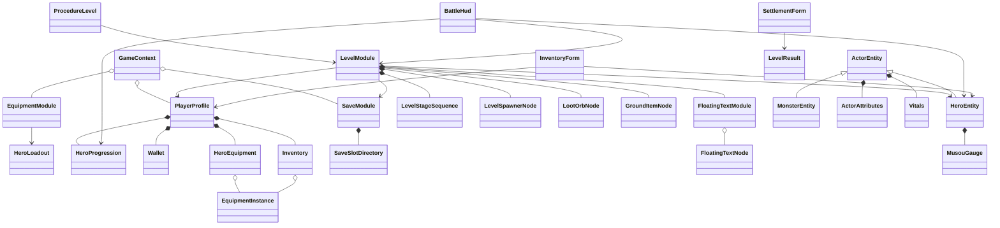
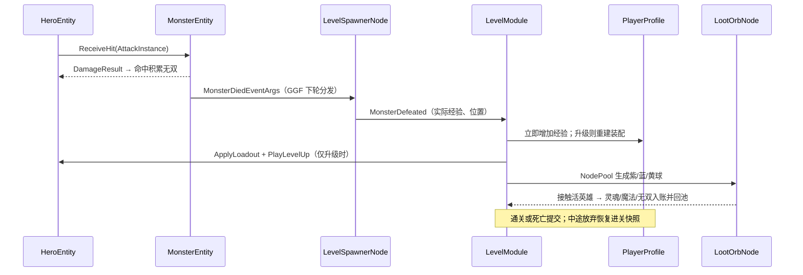

# 项目导览

先读本页，再沿代码入口追一次启动和击杀。唯一规范是 [ProjectGuidelines/AGENTS.md](ProjectGuidelines/AGENTS.md)；官方数值看 [OfficialReference](OfficialReference.md)，素材出处看 [LegacyAssetMap](LegacyAssetMap.md)，检查命令看 [Validation](Validation.md)。

## 启动与返回

`Launch → Update → Preload → Title（开始、六格存档）→ LoadProfile → 新档 Character / 已有档 Map → 点击花果山 → Level`。

当前只有悟空和花果山开放。未解锁角色无交互；选角卡片自带姓名，悬停显示颜色和 1P。关卡清场后靠近出口、落地按 W，待掉落拾取后显示成功结算；死亡保留收益并显示失败结算。成功返回地图，失败可重试或返回地图；导航等待检查点完成。设置中途返回仍回滚。

## 对象与状态归属

| 状态 | 所有者 / 生命周期 |
| --- | --- |
| 累计经验、英雄列表、灵魂、装备实例 | PlayerProfile / 读档到返回标题；检查点保存 |
| 阶段、结局、进关快照、球和地面物品 | LevelModule / 本次关卡 |
| 最终属性、生命魔法、无双 | ActorEntity、HeroEntity / Show 到 Hide，不写盘 |
| 残影、闪烁、血条淡出 | 表现节点 / 关闭、隐藏或复用时复位 |

流程只装配、导航和逆序释放；LevelModule 管本关，SaveModule 管读写。每份状态一个所有者，通过方法修改，Changed 后观察者读取完整快照。纯状态与规则不访问场景树。

## 按顺序阅读

| 入口 | 要看清的问题 |
| --- | --- |
| [GameData](../Godot/GodotProject/TheGame/GameScripts/Save/Data/GameData.cs) | 完整写盘字段：ActiveHeroId、Heroes 的 ID/累计经验、Soul、EquipmentItems 及实际属性；配套记录同文件 |
| [SaveModule](../Godot/GodotProject/TheGame/GameScripts/Save/SaveModule.cs) 和 [Save/README](../Godot/GodotProject/TheGame/GameScripts/Save/README.md) | 六格目录、读档/建档、快照写盘；当前 v6，不兼容旧格式 |
| [GameContext](../Godot/GodotProject/TheGame/GameScripts/GameContext.cs) | 档案与本槽保存入口怎样跨关卡保留 |
| [ProcedureLevel](../Godot/GodotProject/TheGame/MainPack/Scripts/Procedure/ProcedureLevel.cs) | 加载场景、显示英雄、启动关卡、打开 HUD，失败时清理 |
| [LevelModule](../Godot/GodotProject/TheGame/GameScripts/Level/LevelModule.cs) 及 Progress/Loot partial | 相机抵达、开战、清波、奖励、出口、提交与回滚 |
| [FloatingTextModule](../Godot/GodotProject/TheGame/GameScripts/FloatingText/FloatingTextModule.cs) | 场景内通用飘字入口，显式开始/结束；伤害事件按运行实体归属过滤，恢复量直接传入 |
| [ActorEntity](../Godot/GodotProject/TheGame/GameScripts/Entity/ActorEntity.cs) | 出招快照、判定去重、DamageHelper、扣血与死亡事实 |
| [HeroEntity](../Godot/GodotProject/TheGame/GameScripts/Entity/Heroes/HeroEntity.cs) | 输入、身体状态、无双秒制计时与加成 |
| [BattleHud.Logic](../Godot/GodotProject/TheGame/GameScripts/UI/BattleHud/BattleHud.Logic.cs) | 订阅、立即刷新、关闭退订；控件只接收数值 |
| [EquipmentModule](../Godot/GodotProject/TheGame/GameScripts/Equipment/EquipmentModule.cs) | 装备定义、官方随机属性与读档校验；出战和升级共用 CreateLoadout |
| [InventoryForm.Logic](../Godot/GodotProject/TheGame/GameScripts/UI/InventoryForm/InventoryForm.Logic.cs) | 实际属性、经验、灵魂和装备格；悬停查看本件实际值；打开暂停，关闭退订 |
| [SkillForm.Logic](../Godot/GodotProject/TheGame/GameScripts/UI/SkillForm/SkillForm.Logic.cs) 和 [SkillCatalog](../Godot/GodotProject/TheGame/GameScripts/Skills/SkillCatalog.cs) | 造一悟空/唐僧主动与共用被动目录，观察灵魂；本轮只查看，未接入学习与实战释放 |
| [SettlementForm.Logic](../Godot/GodotProject/TheGame/GameScripts/UI/SettlementForm/SettlementForm.Logic.cs) | 只读冻结的 LevelResult，提交带窗口编号的地图或重试事件 |

背包场景按 `Window / CharacterPanel（Identity、EquipmentSlots、Attributes、Experience）/ BagPanel（Tabs、m_BagGrid、Footer）` 分组；出售确认独立为 `m_SaleConfirmation / Center / Panel / Content（标题、摘要、说明、Actions）`，全屏遮罩阻挡背后点击。每项属性有独立的 Caption 与数值 Label。外置 `hero_preview.tscn` 和动画库只含身体、武器与光效表现，不创建第二个战斗实体。

根窗口负责生命周期、订退、暂停和业务请求。只在面板具有完整职责，或控件确实复用、包含独立交互时拆脚本；Footer、Column、行容器等布局分组不需要脚本。面板不拥有档案或执行交易。

| 窗口 | 根绑定数 | 子组件职责 |
| --- | --- | --- |
| InventoryForm | 5 | Character 统一显示身份、穿戴、属性和经验；Bag 统一管理分类、25 格、分页、灵魂和品质选项；SaleConfirmation 负责一次性出售确认；另绑定 Close、Actions |
| SaveForm | 3 | Close、Status、Slots；表单直接收集六格并更新姓名、日期、提示和交互，不设 Grid/Button 脚本 |
| BattleHud | 5（原 12） | Status、Menu、Go、EncounterHealthBar、MusouActivation；Status 显示生命/魔法/经验/等级，Menu 管无双满值提示及三个菜单按钮 |
| SkillForm | 8 | 表单直接处理返回、分类和灵魂，只展示出战角色并禁用其他角色；ActivePage、PassivePage 分别刷新整页，行及行组只负责布局 |

组件脚本按用途归入窗口的 `Components/`，不再设 `GameScripts/UI/Widgets/` 汇总目录：背包的装备格、tooltip、操作菜单、品质格式和预览归 InventoryForm；资源条、守关条和无双开启表现归 BattleHud；地图地点命中归 MapForm。目录移动保留 UID 与稳定命名空间。场景资源仍在既有 `UIs/Widgets/`，不改变资源键；共用 Theme/StyleBox 仍在 `MainPack/Themes/`。其余 Start、Character、Map、Settings、Settlement、SaveNotice 表单没有纯布局包装脚本。第 40 章的 HUD 根绑定旧示例与当前组件装配有差异，按用户当前要求执行，未修改规范正文。

预览采用独立场景组合，动画保存为外置资源；参考 Godot 官方的 [场景组织](https://docs.godotengine.org/en/stable/tutorials/best_practices/scene_organization.html) 与 [Resources](https://docs.godotengine.org/en/stable/tutorials/scripting/resources.html)。数值配置和档案所有权仍遵循本项目的 Luban 与 PlayerProfile 约定。

技能入口走 `BattleHud → SkillsRequestedEventArgs → ProcedureLevel → SkillForm`，与背包、设置互斥。场景按 `Content / Header、m_ActivePage、m_PassivePage、Footer` 分组；十行主动和五行被动直接写在 `skill_form.tscn`，不使用行子场景或行脚本。每行是 GridContainer：主动五列为 Name / IconCell / Soul / Key / DescriptionCell，被动六列为 Name / Level / CurrentEffect / NextEffect / Upgrade / Soul。两个页脚本在初始化时收集本页固定节点，绑定数据时统一刷新；窗口只借用目录、钱包与关卡。返回、Esc 和关卡结束均对称解除暂停及订阅。

在编辑器展开 `Content/m_ActivePage/m_WukongRows/Skill1..5`、`m_TangsengRows/Skill1..5` 或 `Content/m_PassivePage/m_PassiveRows/Passive1..5`，即可直接修改文本与布局。各列的 Custom Minimum Size X 决定列宽，IconCell/Icon 的偏移控制图标，DescriptionCell 的 Margin 控制说明留白；各行在父 Control 中保留可微调的 Y 位置。调整整列时保持该页五行与 Headers 的列宽一致。切换页面的 Visible 可预览唐僧或被动页。场景预填名称、费用、按键、说明及图标，运行时 Bind 总是以正式表覆盖这些展示内容。

战斗 `idle1` 和背包预览 `idle` 共享原版 100 帧、24 fps 的完整待机循环，立棍张望由动画时间轴负责。地面装备和恢复品接触时入账，随后用 `Entitys/Animations/ground_item_pickup_library.tres` 在 0.8 秒内上移 100px 并淡出；关卡保留节点所有权直到动画结束。

悟空五项技能动画挂在实体 AnimationPlayer 的 `skills` 库，源帧按 24 fps 换算为秒；仍共用身体/武器两张可独立替换的图层。大光效位于 `Sprites/Effects/wukong/skills/`，火魔斩分段特效场景在 `Entitys/Effects/Skills/`，外置库在 `Entitys/Animations/Skills/`。原版七段声音在 `SoundConfig` 中按 SoundId 7..13 登记到 GGF SFX。技能数据按职责分为：

| 源表 | 内容 |
| --- | --- |
| SkillConfig / PassiveConfig | 两角色十项主动及共用被动五级目录、费用、说明和图标 |
| SkillHitConfig | 两角色 11 个伤害阶段、舍入位置、击退与源命中参数 |
| SkillActionConfig | 悟空五项动作、起手音、无敌秒数、普攻取消阈值及二段跳消耗 |
| SkillEffectConfig | 五个独立特效的资源、朝向、缩放及声音 |
| SkillTimelineConfig | 悟空 47 条秒制位移、攻击编号、目标分支、落地及结束事件；特效事件使用所属特效的局部时间 |

`SkillCombatConfigHelper` 在启动期校验所有外键、参数与局部时间顺序。火魔斩的目标命中/缺失、落地暂停/恢复和九连编号均已配置；没有添加学习记录、扣费或施放入口。美术原点与复现流程见 [LegacyAssetMap](LegacyAssetMap.md#悟空造一技能动作与声音)，原版规则见 [OfficialReference](OfficialReference.md#造一技能准备)。

英雄输入按 `HeroEntity → HeroInput → Ground/Air → HeroAttackSequence → Attack` 阅读。`HeroInput` 识别按键和松键闩锁；英雄持有的 `HeroAttackSequence` 决定冷却和下一段；Ground/Air 决定进入 Attack，Attack 只管理当前动画、移动与收招。基类保留打断、重力、跳跃和组合输入共用逻辑，不反查派生状态执行方法。普攻不排队：过早输入丢弃，有效输入立即换段；参数在 `HeroConfig`，具体源规则见 [官方输入依据](OfficialReference.md#普攻输入与移动2026-10-14)。

怪物的 `Move → Attack → Recovery` 切换通过 GGF 的 `SetData/GetData/RemoveData` 传递招式下标和收招时长；目标状态在 Enter 时消费参数并自行初始化。状态之间不直接调用 `Arm` 或改写彼此字段。

共享英雄状态按各英雄的参数读取普攻段数、动画名、冷却与空中段号；已用一段、三段配置在 60/120Hz 验证循环和空中出招。悟空的第三段下劈由 `WukongEntity.BuildBodyParams` 指定。新增角色仍由具体实体提供状态集，唐僧的弹道、专属技能及不同攻击移动规则需要各自实现。

当前怪物支持配置多招、独立冷却、选招优先级与收招硬直。飞行行为还有明确限制：`MonsterEntity` 接受攻击请求和 `MonsterMoveState` 消费请求都要求落地；接入飞行怪时需将这一条件交给具体怪物决定。这里与第 30 章“新增飞行行为不修改基类”的目标仍有差距，规范正文保持原样。

背包显示悟空、唐僧的粗糙/普通装备共八种；详情显示实例的具名实际属性。点击格子打开装备、赠送、出售菜单，单人赠送禁用，异角色不能穿戴。武器与防具独立换装；替换时旧装备回包，满包不能卸下，换装不补血。售价来自装备表（粗糙 10、普通 20 灵魂）。C 对应 inventory_toggle 输入动作，打开暂停、关闭恢复；分类可切换，装备 75 格分三页，其余分类尚无物品内容；底部两行分别放灵魂/一键出售、上一页/页数/下一页，出售向上展开各品质，选择后确认件数和收益，再提交整包交易，排除穿戴物。数值沿用造梦一，提示及操作菜单按造梦三公开原资源实现。

人物穿戴槽的“武器／防具”字样来自底图。两槽各用独立且随场景实例化的 `equipment_slot_background.gdshader` 材质，EquipmentCell.Bind 在已有装备时开启 occupied；shader 取原图无字内侧列的同一行颜色清除题签，保留渐变和边框。卸下恢复原图，透明装备图标不改，背包格不使用该材质，也不新增装备表路径。

一键出售、品质上拉菜单和出售确认/取消按钮共用 `MainPack/Themes/brown_gold_theme.tres`，场景不再内嵌主题与 StyleBox。`Themes/Styles/` 下的 `brown_gold_button.tres` 使用原版棕金渐变底图；`brown_gold_button_active.tres` 保留截图中的原深棕纯色，供悬停/按下/禁用共用；`gold_focus_border.tres` 只画焦点边框。品质菜单使用 `brown_popup_panel.tres` 的深棕底和浅金文字；确认面板使用独立的 `brown_dialog_panel.tres`。其他窗口可在根 Control 的 Theme 中引用该主题，或在 Theme Overrides 中单独引用所需 StyleBox。

StyleBox 定义背景、边框、圆角和内容留白；Theme 按控件类型和状态引用 StyleBox，并配置字体、字号和颜色。比如 `Button/styles/normal` 指向常态背景，`Button/styles/hover` 与 `pressed` 指向交互背景。根 Control 的 Theme 供后代控件继承；某个控件的 Theme Overrides 优先于共享主题，确认框的 PanelContainer 就直接覆盖 `Styles/panel`。普通 Button 使用这些状态样式；TextureButton 的背景来自其各状态纹理。

装备 tooltip 沿用 Godot 的悬停、定位和销毁机制。`EquipmentCell.Bind` 设置 TooltipText；Godot 调用其 `_MakeCustomTooltip` 时，实例化导出字段 `m_TooltipScene` 指向的 `UIs/Widgets/equipment_tooltip.tscn`，注入实际装备属性并返回该 Control。面板按 `Content/Header（名称、品质、类型）/ Attributes（动态属性）/ Footer（说明、价格）` 排列；编辑这个场景即可调整内容布局。格子的局部 `tooltip_theme` 将 `TooltipPanel/styles/panel` 设为 StyleBoxEmpty，消除 Godot 外壳的背景和留白，实际底板由返回的 EquipmentTooltip 自己绘制；这两个资源均有用途。悬停延迟在项目设置 `gui/timers/tooltip_delay_sec`，当前为 0 秒。

结算展示实际游玩秒数（不含暂停）、剩余生命比例、击败数和发放经验。连击与评分尚未实现，因此未显示虚构成绩。按本次用户要求替换第 60 章旧的自动重开/直接回地图行为，并将装配工厂从 HeroLoadout.Create 移到 EquipmentModule.CreateLoadout，HeroLoadout 保留为不可变输入；规范正文的旧描述保留待用户同步。

## 追一次击杀

跨模块的一次性结果用 GF.Event，状态变化用 Changed，所属模块协作用直接调用。池化事件不跨 await 保存；测试读取 IFsm、节点或反射，不加生产观测接口。

## 文件放哪里

| 功能 | 目录（相对 GameScripts） |
| --- | --- |
| 属性、资源、攻击与伤害规则 | Battle/{Attributes,Resources,Attacks,Damage} |
| 档案成长与钱包 | Profile |
| 保存入口、DTO、目录显示 | Save 根目录、Data、Slots |
| 英雄/怪物与身体/AI | Entity/{Heroes,Monsters,Body} |
| 关卡入口 | Level/LevelModule*.cs |
| 关卡内部功能 | Level/{Camera,Spawning,Stages,Markers,Exit}，详见 [Level/README](../Godot/GodotProject/TheGame/GameScripts/Level/README.md) |
| 窗口、控件 | UI 下每窗一目录、Widgets |
| 世界飘字 | FloatingText；伤害/闪避、生命/魔法恢复样式，池场景位于 Entitys/Effects |
| 配置输入 / 生成物 | Configs/GameConfig/Datas/*.xlsx / GameProto 和 DataTables |

Module 是模块入口，Node 是内部 Godot 组件，Helper 是无状态方法，Resource 是资源。按功能聚合，不把所有节点集中到 Nodes。身体状态表达动作与打断；BodyFsmHelper 的 C# 14 扩展成员 `fsm.Tick(dt)` 负责物理调度。

## 常改位置

- 无双数值：BattleConfig.xlsx 的 Ws 字段，含义与官方依据集中在 OfficialReference；角色参数不被开启/结束反复改写。
- 满值提示：`Sprites/UI/hud/hud_ws_full_frames.tres`；圆形范围在 BattleHud 的 m_WsMax 材质参数中改。
- 开启大立绘：`Sprites/UI/hud/musou_activation/musou_activation_frames.tres`，独立于满值闪烁。
- BOSS 条：`UIs/Widgets/encounter_health_bar.tscn`；姓名和笔刷条构成顶部组件，无生命数字。
- 地图悬停：LocationGlow.Scale 调尺寸，AnimationPlayer.SpeedScale 调速度；命中跟随可见轮廓。
- 新持久字段：领域状态 → GameData → ProfileSaveHelper 双向映射/回滚 → 格式版本与验证。
- 悟空动作：先看 [官方五段攻击](OfficialReference.md#悟空五段普攻)，再看 [独立图集及原点](LegacyAssetMap.md#悟空独立身体与武器)；AnimationLibrary 管帧/特效/判定，AttackConfig 管威力/击退/声音，身体状态只驱动动作。

在 Godot 对 `TheGame/Scenes/TestArena.tscn` 按 F6 可观察战斗，它只创建内存档案。正式流程断点从 ProcedureLevel、OnHitLanded、OnMonsterDefeated、AddExperience、SubmitOutcome 开始。后续系统落位见规范第 60 章。

## 地面物品与地图提示

装备在死亡时生成唯一实例并抽属性；`LootHelper.RollGround` 只选择定义，`LevelModule.Loot` 借助 GGF 节点池创建和拥有 `GroundItemNode`。物品受重力落地，接触后才恢复或入包，暂停时不计过期，10 秒未领取回收。地面只显示官方掉落图，不显示名称；背包使用另一套原版图标。满包不销毁、不重抽；出口只等飞行球，不等待未拾取的地面物品。

当前保存格式 v6：GameData 平铺英雄经验、灵魂、装备实例及具名属性；Heroes 中以实例 Guid 引用穿戴物。PlayerProfile.Inventory 只含未穿戴物，HeroEquipment 保存穿戴；HeroLoadout 将基础属性和当前两件装备冻结后交给实体。旧格式不做运行时兼容。已按用户授权备份原 v4 开发档，再一次性转存累计经验 1020 和灵魂 835；原件保留在 GameData.backup-before-v6-20261013-025550，正式主档与备份均经 v6 读取验证。第 20/30/50/60/70 章旧名称与版本尚未同步，本轮只按用户明确要求补充第 40 章美术定位规则。

地图打开和鼠标离开后播放外置 `location/current` 边缘闪烁，悬停播放 `location/hover`；关闭时 RESET 并停止，复用重新启动。当前只有花果山开放，因此最新提示就是花果山；多关解锁进度尚未实现，不新增虚构进度字段。用户当前指令覆盖第 40 章旧的离开即停止提示描述；规范正文未自行修改。

恢复品和蓝球实际领取后，调用本场 `FloatingTextModule.ShowRecovery(position, amount, RecoveryKind.Health/Mana)`：生命数字绿色，魔法数字蓝色；显示配置恢复量（即使已达上限），一秒上移 75px，暂停停止。模块只显示反馈，实际恢复仍由拾取业务结算；后续技能恢复可复用该入口。

`Level_1` 和 `TestArena` 均在 `World/FloatingText` 绑定同一个组件。组件在 `StartSession/StopSession` 成对订阅 GGF 伤害事件；参数携带受击时的运行实体编号，拒绝其他场景和旧实体的排队事件。所有样式共用 `FloatingTextNode` 与 `Entitys/Effects/floating_text.tscn` 的一个池：伤害居中、放大后淡出，恢复左起匀速上升，闪避使用贴图；共用数字布局、秒制计时、完成回调和回池复位。数字按实际可见轮廓宽度排布，间隙由场景根脚本的 `m_DigitGap` 控制，默认 0px，窄字另按 `m_NarrowGlyphPadding`（默认 1/6）补充侧留白；字宽按图集首次使用缓存，帧更新不读图。模块只逐个归还本会话取出的节点，不使用全池清空；表现节点不订阅业务事件、不自行访问全局池。规范第 00/10/60 章的旧 DamagePopPresenter/UI 目录示例尚未同步，本次按用户要求以场景模块替换，未自行改写规范正文。

怪物 AI 的范围与目标盒直接使用 `Godot.Rect2`（纯 C# 值类型，不依赖场景树），合并/中心/空矩形采用原生 API。`AttackReachHelper` 只补朝向镜像与有符号间隙；不再维护重复的 AiBox 结构。
