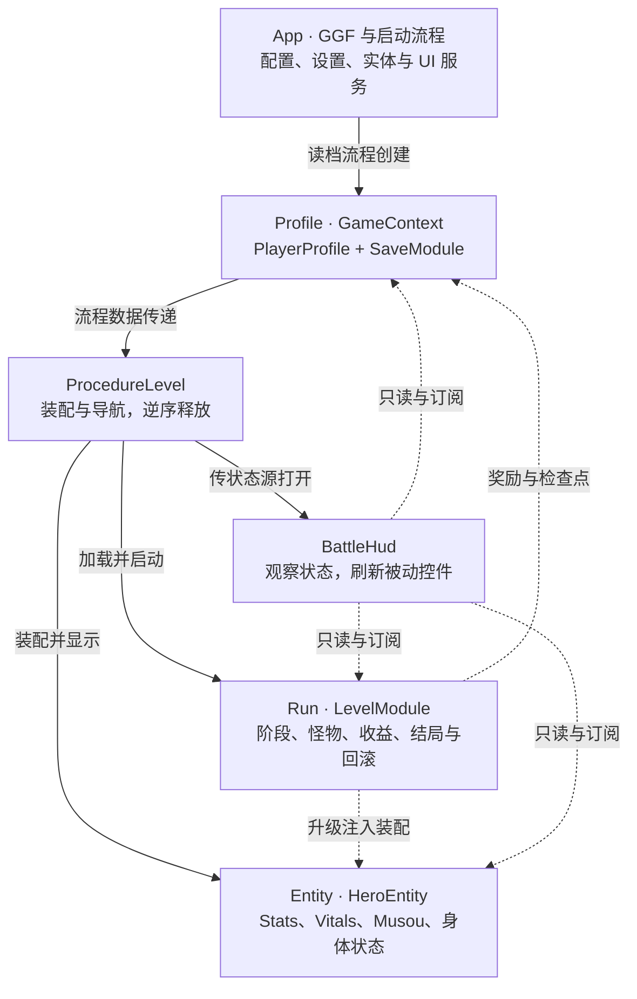
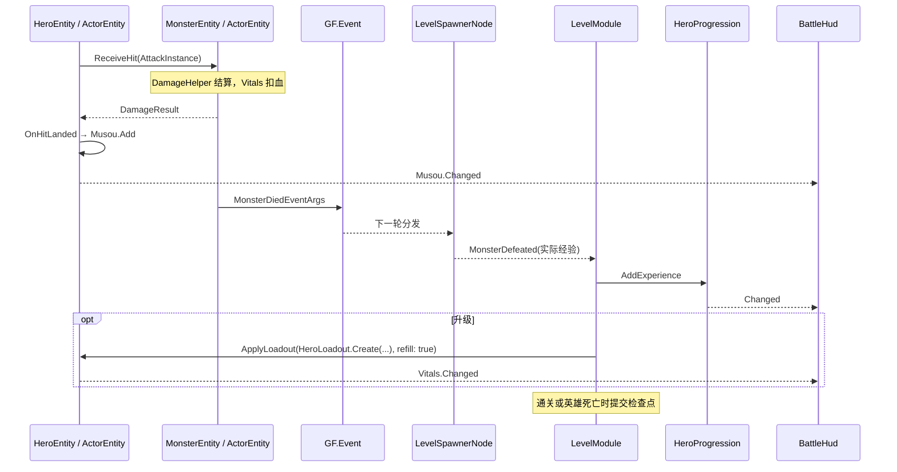
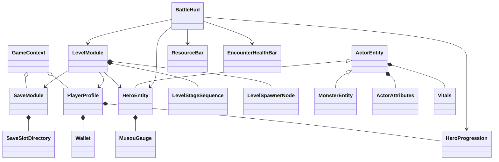

# GameZMXY：项目导览

核对日期：2026-10-12。这是当前实现的阅读地图，唯一规范是 [ProjectGuidelines](ProjectGuidelines/AGENTS.md)。用“作用域 → 一次击杀 → 局部类图”熟悉项目，再沿代码链接阅读。模块目录与出口时序见 [GameplayArchitecture](GameplayArchitecture.md)，本轮修改和验收见 [ModuleRefactor](ModuleRefactor.md)。

## 1. 状态归谁



| 状态 | 唯一所有者 | 生命周期 / 是否写盘 |
| --- | --- | --- |
| 英雄累计经验、成长、金币 | PlayerProfile 下的 HeroProgression / Wallet | 档案作用域；检查点写盘 |
| 本关结局、获得经验、进关快照 | LevelModule | 本次关卡；统计与快照不写盘 |
| 当前生命魔法、最终属性、无双 | ActorEntity.Stats/Vitals、HeroEntity.Musou | 实体 Show → Hide；不写盘 |
| 当前阶段、可否前进 | LevelStageSequence、LevelModule.TravelAvailable | 关卡会话；不写盘 |
| 血条残影、满值闪烁 | 被动控件与动画节点 | 窗口关闭或复用时复位 |

原 LevelRun 与 LevelController 已合并为 **一个 LevelModule**。流程只操作模块入口，模块内部各组件承担实际职责；不再逐层转发同一个结局。领域状态与纯规则不反向访问场景树。

## 2. 跟一次启动

`Launch → Update → Preload → Title（开始、六格存档）→ LoadProfile → 新档 Character / 已有档 Map → 点击花果山 → Level`。

当前只有悟空和花果山可进入。未解锁角色完全无交互，悬停不恢复颜色、不显示 1P。通关清场后靠近出口按 W，检查点写盘完成即回地图；死亡提交后按配置重开；设置中途返回地图或标题会回滚到进关快照。

建议依次阅读：

1. [GameData](../Godot/GodotProject/TheGame/GameScripts/Save/Data/GameData.cs)：全部写盘字段集中在一个文件。
2. [SaveModule](../Godot/GodotProject/TheGame/GameScripts/Save/SaveModule.cs) 与 [存档说明](../Godot/GodotProject/TheGame/GameScripts/Save/README.md)：目录 → 读档/建档 → 保存；不做旧格式兼容。
3. [GameContext](../Godot/GodotProject/TheGame/GameScripts/GameContext.cs)：哪些对象跨关卡保留。
4. [ProcedureLevel](../Godot/GodotProject/TheGame/MainPack/Scripts/Procedure/ProcedureLevel.cs)：加载场景、显示英雄、启动模块、打开 HUD，失败或离开时逆序清理。
5. [LevelModule](../Godot/GodotProject/TheGame/GameScripts/Level/LevelModule.cs) 与 [Progress partial](../Godot/GodotProject/TheGame/GameScripts/Level/LevelModule.Progress.cs)：阶段推进、奖励、结局、检查点与回滚，同一个对象。

菜单窗口只发具名 GGF 请求，流程核对窗口编号后导航。`MenuProcedure` 共享窗口、音乐、取消和返回标题的等待；窗口不创建关卡。声音经 `Audio/SoundHelper` 交给 GGF 管理。输入映射在 `Input/InputActions`，HeroEntity 采样 Godot Input，缓冲、双击与消费规则在 `Entity/Heroes/Input/`。

## 3. 跟一次击杀

无双来自有效命中，经验来自击败奖励。



| 步骤 | 代码入口 |
| --- | --- |
| 命中去重、受击、死亡事实 | [ActorEntity](../Godot/GodotProject/TheGame/GameScripts/Entity/ActorEntity.cs) |
| 无双收益 | [HeroEntity.OnHitLanded](../Godot/GodotProject/TheGame/GameScripts/Entity/Heroes/HeroEntity.cs) |
| 纯伤害规则 | [DamageHelper](../Godot/GodotProject/TheGame/GameScripts/Battle/Damage/DamageHelper.cs) |
| 本关实体所有权、名额与击败事实 | [LevelSpawnerNode](../Godot/GodotProject/TheGame/GameScripts/Level/Spawning/LevelSpawnerNode.cs) |
| 奖励、升级、结局 | [LevelModule.Progress](../Godot/GodotProject/TheGame/GameScripts/Level/LevelModule.Progress.cs) |
| UI 订阅、刷新、退订与复位 | [BattleHud.Logic](../Godot/GodotProject/TheGame/GameScripts/UI/BattleHud/BattleHud.Logic.cs) |

直接调用表达协作，Changed 表达状态已完成修改，GF.Event 表达跨模块的一次性事实。池化事件不能跨 await 保存。

## 4. 局部类图与功能目录



Level 根目录只保留模块入口及其 partial；内部按功能归组，各组可同时包含节点、规则与资源：

| 目录 | 查什么 |
| --- | --- |
| Camera | 相机取景、死区与抵达；LevelCameraNode + LevelCameraHelper |
| Spawning | 生成点、配方调度和本关实体所有权 |
| Stages | 阶段状态、区域门与特殊触发区 |
| Markers | 各空间集合共用的登记基类与条目资源 |
| Exit | 清场后开放、靠近、落地、按 W 的出口交互 |

Module 是模块入口，Node 是内部 Godot 节点，Helper 只提供无状态方法，Resource 是 Godot 资源；Entity/Form/Hud/Bar/Button 已说明节点种类，保留后缀。BodyFsmHelper 使用 C# 14 extension 块提供 `fsm.Tick(dt)`；BodyState 表达单个动作，状态查询直接用 IFsm.CurrentState。测试反射留在 Debug/Tests，不为冒烟新增生产接口。

## 5. 修改表现与保存字段

`Save/Data/GameData.cs` 直接保存 ActiveHeroId、Heroes（HeroId + TotalExperience）、Gold；等级和属性重算，生命、魔法、无双、位置和波次不写盘。增加持久字段时同时修改领域状态、GameData、ProfileSaveHelper、版本号及映射/回滚验证。

无双满值动画外置在 `Sprites/UI/hud/hud_ws_full_frames.tres`，只在满值时循环，消费、关闭或改绑后复位。圆形闪烁参数位于 `BattleHud.tscn/MenuPanel/m_WsMax` 的 Material → Shader Parameters：clip_radius 默认 32、clip_center 默认 (0.5,0.5)、clip_feather shader 默认 1（当前场景保留用户调整值 0）；半径与羽化单位为原帧像素。GPU 检查入口为 `EditorScripts/validate_musou_flash.gd`。

守关条独立场景为 `UIs/Widgets/encounter_health_bar.tscn`，左侧白字黑边姓名、右侧笔刷条，不显示生命数字，无入场弹窗。小怪受伤后两秒淡出，继续受伤重新计时。地图悬停动画外置在 `Sprites/UI/frontend/map_location_hover.tres`；放大改 LocationGlow.Scale，速度改 AnimationPlayer.SpeedScale，命中随当前可见图片变化。

## 6. 动手熟悉与验证

先在 Godot 中对 `TheGame/Scenes/TestArena.tscn` 按 F6，观察英雄和怪物；场地只创建内存档案，不读写玩家存档。再运行正式项目追一次击杀。断点可以放在 ProcedureLevel.OnEnter、HeroEntity.OnHitLanded、LevelModule.OnMonsterDefeated、HeroProgression.AddExperience、BattleHud.RefreshMusou 和 LevelModule.SubmitOutcome。

```powershell
dotnet build Godot/GodotProject/GodotProject.csproj
dotnet test Tests/BattleTests
dotnet test Tests/LevelTests
dotnet test Tests/ProfileTests
python Tools/ProjectMaintenance/validate_game_references.py
& 'S:/Godot4/Godot4CSharp_console.exe' --headless --path Godot/GodotProject -- --smoketest=ui
```

烟测使用隔离 Validation 存档，以 SMOKE PASS/FAIL 判断断言，同时检查进程退出码和错误。框架关停异常与插件退出崩溃单独登记在 [验证记录](ModuleRefactor.md)，不把断言通过当成无错误退出。框架左上角调试入口由 ProcedureLaunch 通过 GF.Debugger.ActiveWindow=false 隐藏。

新增功能先明确配置输入、状态所有者和生命周期，在对应模块扩展。集中规范第 60 章给出背包、装备、技能、Buff 等后续系统落位；不要从旧项目复制第二套架构。
