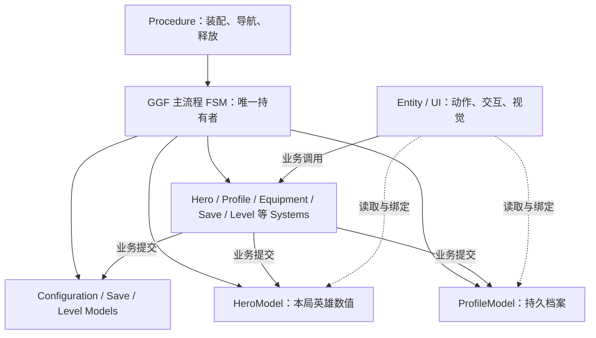
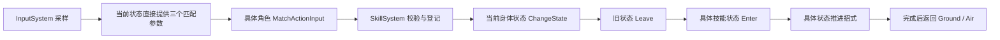

# 项目导览

唯一规范是 [ProjectGuidelines/AGENTS.md](ProjectGuidelines/AGENTS.md)。本页记录当前实现；数值看 [OfficialReference](OfficialReference.md)，素材看 [LegacyAssetMap](LegacyAssetMap.md)，验证命令和结果看 [Validation](Validation.md)。修改前先读 [沟通理解与当前方向](WorkingNotes.md)，其中保存最新意图及设计判断。

## 启动与返回

`Launch → Update → Prepare → Preload → Title（开始、六格存档）→ LoadGame → 新档 Character / 已有档 Map → 花果山 → Level`。

当前开放悟空和花果山。未解锁角色没有交互。通关和死亡保留收益并保存，中途放弃恢复进关快照；返回地图或重试前等待检查点写盘。

## Architecture 与职责

参考 [QFramework 架构规范](https://github.com/liangxiegame/QFramework#架构使用规范) 与 [核心源码](https://github.com/liangxiegame/QFramework/blob/master/QFramework.cs)：官方允许 Model 提供增删查改。本项目按用户要求采用更集中的职责：Model 保存数据并提供查询，System 直接修改数据属性并维护业务规则，避免两层同名修改方法和纯转发。

本项目沿用 **GGF 主流程 FSM 的 GetData/SetData 作为唯一注册存储**，Architecture 只提供访问视图。契约集中在 [ArchitectureContracts.cs](../Godot/GodotProject/TheGame/GameScripts/Architecture/ArchitectureContracts.cs)，不引入 QFramework 依赖或第二个容器。

| 角色 | 职责 | 访问能力 |
| --- | --- | --- |
| Model | 拥有权威状态、绑定属性和只读查询 | Utility |
| System | 直接修改 Model 属性，负责计算、交易、奖励、保存与回滚 | Model、System、Utility |
| Controller | 节点、输入、动作、视觉；读 Model、调用 System、订退绑定 | Model、System、Utility |
| Utility | 转换、共享计算或 GGF 适配；不保存 Architecture / Model 引用 | 显式调用参数 |
| Procedure | 注册、初始化顺序、导航、取消、逆序释放 | 明确的流程 FSM |

Utility 直接实现 IUtility，不增加空工具基类；SaveDataUtility 的输入是待转换的 ProfileModel 与 SkillModel，不反向查询架构。ExperienceCurve 在 Prepare 独立注册为共享 Utility，ConfigurationModel 不再重复持有它。三个 Get 返回所属 FSM 的同一引用；未注册返回 null，过期 Architecture 报生命周期错误。Model/System 有各自初始化基类，节点和窗口保留 Godot/GGF 继承链并实现 IController。外部读取只读绑定，业务修改经 System；不为每次按钮操作再增加 Command 类。

## 所有者与初始化位置

**FSM 持有 Model 和 System，其他对象借用。** Model 不持有节点；Entity 不创建私有 Model。按生命周期和数据归属合并，共六个 Model：

| Model | 唯一拥有的数据 | 注册位置 / 生命周期 |
| --- | --- | --- |
| ConfigurationModel | Tables、只读查询索引、共享身体参数 | ProcedurePrepare / 应用期 |
| SaveModel | 当前文件编号、六格摘要、目录与手动保存状态 | ProcedurePrepare / 应用期 |
| [ProfileModel](../Godot/GodotProject/TheGame/GameScripts/Profile/ProfileModel.cs) | 英雄身份、累计经验和派生进度、各英雄穿戴、背包、灵魂 | ProcedureLoadGame 校验读档后 / 读档 → 回标题 |
| [SkillModel](../Godot/GodotProject/TheGame/GameScripts/Skills/SkillModel.cs) | 每名英雄的学习记录、当前技能组、活动执行和秒制无敌时限 | ProcedureLoadGame / 读档 → 回标题；施放临时数据离关清空 |
| [HeroModel](../Godot/GodotProject/TheGame/GameScripts/Battle/HeroModel.cs) | 本局最终属性、等级、HP/MP/WS、无双状态与计时、基础值及修正来源 | ProcedureLevel 场景加载后 / 进关 → 离关 |
| LevelModel | 阶段、计时、统计、结局、成绩、进关快照和前进窗口 | ProcedureLevel / 本局 |

成长、穿戴、背包和灵魂直接存入 ProfileModel，没有内层子 Model。生命、蓝量、无双、攻击、暴击等统一存入 HeroModel。两者分别代表持久档案和本局数值，退出关卡只移除后者。配置、存档操作状态、关卡流程各自保留，避免混淆应用和本局的清理范围。

| System | 业务职责与涉及数据 |
| --- | --- |
| HeroSystem | 读取 ProfileModel 与配置，汇总成长/装备/Buff、管理生命魔法、无双增长与秒制消耗、查询无双倍率，提交 HeroModel |
| ProfileSystem | 经验与灵魂奖励、领取装备的唯一归属校验、完整检查点回滚，提交 ProfileModel |
| EquipmentSystem | 随机装备、穿戴交换、卸下、出售和批量出售；配置 + ProfileModel 的事务 |
| SkillSystem | 学习/扣费、激活检查/扣蓝、活动执行登记/推进/结束、后续输入和换组清理；SkillModel + HeroModel + ProfileModel |
| SaveSystem | 目录、读档、建档、检查点写盘、手动保存结果与旧请求校验；SaveModel + ProfileModel + SkillModel + ArchiveUtility |
| LevelSystem | 阶段迁移、有效游戏时间、收益入口、结局提交与放弃回滚；LevelModel + 上述业务系统 |
| ConfigurationSystem | 启动配置校验、首次建立共享身体参数并存入 ConfigurationModel |
| Combat / Input / MonsterAi / Loot Systems | 共用伤害、输入、AI 决策和掉落规则；各实体自己的动作/FSM 数据不强行注册成全局 Model |

Prepare 注册应用模型与系统；LoadGame 注册 ProfileModel、SkillModel → ProfileSystem（恢复检查点）→ EquipmentSystem、SkillSystem；Level 注册 LevelModel、HeroModel → HeroSystem → LevelSystem。HeroSystem 初始化全部数值并订阅档案成长与穿戴，之后才显示 Entity、打开 HUD。F6 TestArena 在独立 FSM 注册内存 ProfileModel、HeroModel 和相应系统，不读正式存档。

离关：关窗退订 → 停止场景协作 → 移除 LevelSystem/LevelModel → 隐藏英雄 → 移除 HeroSystem/HeroModel → 卸载场景。回标题先等待写盘、完成回滚和离关，再移除 EquipmentSystem、SkillSystem、SkillModel、ProfileSystem、ProfileModel。应用模型保留。



怪物各自拥有普通生命、防御和 AI 数据，其余数值读配置；不借用玩家 HeroModel。英雄动作输入和身体 FSM、怪物 AI/FSM、节点与运动状态仍由各 Entity 管理。

## Model 的属性绑定

[BindableProperty](../Godot/GodotProject/TheGame/GameScripts/Architecture/BindableProperty.cs) 保存单值，成长、穿戴、目录等关联字段用不可变状态值承载。[BindableList](../Godot/GodotProject/TheGame/GameScripts/Architecture/BindableList.cs) 基于 `Collection<T>`，直接拥有列表；[BindableDictionary](../Godot/GodotProject/TheGame/GameScripts/Architecture/BindableDictionary.cs) 实现泛型 `IDictionary<TKey, TValue>`。Model 持有同一个容器，System 使用正常赋值和集合操作，UI 只读并订阅。

| 状态源 | 观察入口 |
| --- | --- |
| HeroModel | Level、Hp / Mp / Ws / MaxWs / WsActive、全部 16 项最终属性 |
| ProfileModel | Progress、Slots、Soul、EquipmentDatas；GetProgress/GetSlots(heroId) 返回指定英雄的同一绑定 |
| SaveModel | Directory、ManualSave |
| LevelModel | Outcome、TravelAvailable |

三个容器的 `Register(callback, int priority = 0)`、`RegisterWithInitValue(callback, int priority = 0)` 均只传当前值。优先级越大越先执行，同优先级按注册顺序；首次初始化立即调用本次注册的回调。`UnRegister` 使用同一个方法，重复注册时移除最近一次。分发期间增删订阅，从下一轮分发生效；嵌套赋值同步执行，各轮属性回调保留各轮的新值参数。

`HeroSystem` 对成长和穿戴的同步订阅使用 `priority: 100`，窗口默认 `0`。即使窗口先注册，也先重算英雄属性再刷新该档案状态的 UI。优先级只决定同一状态源的回调顺序，不把多个独立属性变成一次整体通知。属性通过 `Value` 立即同步通知，相等值不通知；没有手动补发通知 API。`SetValueWithoutEvent` 保留 QFramework 的明确静默设置语义，正式业务不使用它拼装交易。

集合 API 对照 QFramework 的 [BindableList 源码](https://github.com/liangxiegame/QFramework/blob/master/QFramework.Unity2018%2B/Assets/QFramework/Toolkits/_CoreKit/BindableKit/Scripts/BindableList.cs) 与 [BindableDictionary 源码](https://github.com/liangxiegame/QFramework/blob/master/QFramework.Unity2018%2B/Assets/QFramework/Toolkits/_CoreKit/BindableKit/Scripts/BindableDictionary.cs)。列表支持 Add、Insert、索引替换、Remove、RemoveAt、Clear、Move、Contains、CopyTo 与枚举；字典支持键索引、新增、替换、删除、查询、Keys、Values、CopyTo 与枚举。逐项通知使用普通 C# 事件：OnAdd / OnRemove / OnReplace / OnClear / OnCountChanged，列表另有 OnMove；替换和移动不触发数量变化。与 QFramework 相同，索引原位赋入相等元素仍是一次替换操作。事件只传本次内容，移动事件保留前后索引，不再传前后值。逐项事件先于整表刷新，事件内部按普通 C# 注册顺序调用。

列表 `ReplaceAll` 是实际的整表替换操作：先完整复制输入再写入，失败时原表不变；相同内容不通知，成功时发 OnReset 和一次整表刷新。它用于读档回滚和批量出售，不提供静默替换或外部手动通知。集合绑定参数是同一个实时只读视图，后续修改会反映在视图中；需要历史副本时调用方显式复制。构造和 ToBindableList / ToBindableDictionary 转换会复制外部集合，避免别处直接修改绕过通知。字典保留输入的键比较器；不移植 QFramework 的旧二进制序列化接口，保存仍经 GameData。

HeroSystem 执行 `(基础 + 固定加值) × (1 + 加算百分比之和) × 各乘算倍率`，更新最终属性，再钳制 HP/MP、更新等级。升级补满生命魔法，换装保留其他来源且不补血；技能/Buff 经 SetSource / RemoveSource。无双先更新上限、当前值，再更新开启状态；死亡直接扣血并关闭无双，死亡动作由 Damage 返回值交给实体处理。没有 Model.AddExperience / Damage / Complete 等业务转发。

窗口 OnOpen 订阅并刷新，OnClose 对称解除；关窗先于模型移除，OnRecycle 不查询已结束的模型。HUD 的无双开启动画只订阅变化，不使用初始化回调，因此开窗不会重复播放已开启的无双动画。

```csharp
void RefreshSoul(int soul) => soulLabel.Text = soul.ToString();
this.GetModel<ProfileModel>().Soul.RegisterWithInitValue(RefreshSoul);

// 系统同步优先于默认优先级的窗口刷新。
profile.Progress.Register(OnProgressChanged, priority: 100);

this.GetSystem<EquipmentSystem>().TryEquip(instanceId);
this.GetSystem<HeroSystem>().Heal(amount);

this.GetModel<ProfileModel>().Soul.UnRegister(RefreshSoul);
```

## 绑定、局部回调与 GGF Event

| 场景 | 使用方式 |
| --- | --- |
| 观察持续状态，如余额、成长、HP、目录、结局 | Model 的 BindableProperty / BindableList / BindableDictionary |
| 场景内协作、窗口向所属流程提交导航请求 | 对象的具名局部回调，开始/结束对称订退 |
| 跨职责的一次性事实，如伤害、死亡、保存成功 | GGF 池化 Event |

Event 目录只保留 Combat、Save：DamageDealt 用于伤害/闪避反馈，MonsterDied 用于刷怪名额与奖励，SaveSucceeded 触发应用级成功提示。UiRequestKind 和 UiRequestEventArgs 已删除。窗口暴露 SettingsRequested、LevelSelected 等具名回调，流程按实际窗口类型接入，并校验窗口编号；打开窗口仍使用 GGF OpenUIForm。新建异步窗口由框架成功事件接入，池复用同步返回后立即接入，绑定幂等；关闭清空本次回调，迟到成功通知不能重新绑定已关闭窗口。

普通关窗直接调用 GGF UI。`TitleRequested?.Invoke(SerialId)` 表示退出游戏作用域的导航请求：Procedure 必须等待写盘、取消旧异步工作、回滚未提交收益、关闭关联窗口、清理关卡并切换主流程。直接 OpenUIForm(StartForm) 只会打开画面，无法完成这些生命周期工作；窗口编号用于拒绝复用窗口的旧请求。

绑定与窗口局部回调同步执行，GF.Event 在下一轮框架轮询分发。保存按钮可先收到模型结果，再显示一次性成功提示；测试和调用方须区分边界。池化 GameEventArgs 分发后失效，异步处理先复制需要的值，不跨 await 持有事件参数。

## 配置、存档和场景数据

HeroLoadout、PlayerModel、SaveLoadResult 这类只转交可直接获取对象的包装已删除。保留 CombatantAttributes（冻结已发攻击）、GameData（检查点 DTO）、LevelResult（冻结成绩）。BattleFormData / InventoryFormData 只传英雄与场景表现上下文，不传共享 Model；HeroProgressionState / EquippedItems 是模型内关联字段的一次提交值，防止观察者看到半次更新；HeroActionData 和 MonsterAiData 归各实体自己的输入/FSM。这些对象有独立职责，不按名字含 Data 就机械合并。

[AttackData](../Godot/GodotProject/TheGame/GameScripts/Battle/Attacks/AttackData.cs) 保存一次出招的属性快照、威力、击退与命中去重记录，由出招实体或独立特效创建并归还 GGF 引用池，受击方只在结算期间借用。[EquipmentData](../Godot/GodotProject/TheGame/GameScripts/Equipment/EquipmentData.cs) 保存一件装备的 InstanceId、定义编号和已抽取属性，由 ProfileModel 持有，掉落未拾取前由地面节点持有；UI 借用同一份数据。InstanceId 区分同名的不同装备；存档仍使用独立 EquipmentSaveData，配置范围校验归 SaveDataUtility。DamageResult、MonsterSpawn、SkillDefinition 等名称已经表达结果、出生参数和登记职责，保留原名。

读档：SaveSystem → ArchiveUtility → GameData → SaveDataUtility.Validate → ProcedureLoadGame 创建并注册 ProfileModel、ProfileSystem、EquipmentSystem。加载仅返回 DTO 与 Loaded/Created 来源，后续访问直接 GetModel。

保存：SaveSystem → SaveDataUtility.Capture(profile, skills) → GameData → ArchiveUtility。回滚：LevelSystem → ProfileSystem.RestoreCheckpoint(snapshot)，先完整校验快照，再通过正常属性与集合入口恢复 ProfileModel。SaveDataUtility 仅校验和转换，不写 Model 或文件；ExperienceCurve 同样经 GetUtility 借用，不缓存共享引用。地图流程调用 SaveSystem.SaveManuallyAsync，系统统一管理等待、结果与旧请求校验。

GroundItemNode 使用场景中的固定 32×40 盒，不读图片像素或创建 PhysicsShapeQueryParameters2D。关卡每步把本关英雄交给 TryCollect，按预设盒与受击盒接触后校验收益；满包保留并重试，暂停不拾取。图标底部对齐落地点；固定尺寸可在 ground_item.tscn 的 Shape 调整。

飞行球由关卡传入当前目标位置。蓝量灵魂只回蓝，不产生蓝色飘字；桃子、蓝瓶等地面恢复品继续显示恢复数字。通关、死亡保存已拾取收益，放弃恢复进关快照。当前 v7 的字段和写盘入口见 [存档说明](../Godot/GodotProject/TheGame/GameScripts/Save/README.md)。

## 按顺序阅读

1. ProcedurePrepare → FsmArchitectureExtensions：注册顺序和唯一存储。
2. ProcedureLoadGame → ProfileModel / ProfileSystem：档案归属与事务。
3. ProcedureLevel → HeroSystem / HeroModel → AbstractHeroEntity：数值与表现分离。
4. LevelSystem / LevelViewController：业务事务与场景协作。
5. EquipmentSystem → InventoryForm.Logic：换装、出售和绑定刷新。
6. SaveSystem → SaveDataUtility → GameData：写盘字段与转换。

第 00/10/70 章仍有禁止 Architecture/绑定、统一 Changed、PlayerProfile 和旧存档版本等旧约定，与用户后续要求冲突。当前按最新指令实施，规范正文未自行改写；Framework、addons 和生成物边界见第 50 章。

## 界面、动作与资源

背包场景按 `Window / CharacterPanel（Identity、EquipmentSlots、Attributes、Experience）/ BagPanel（Tabs、m_BagGrid、Footer）` 分组；出售确认独立为 `m_SaleConfirmation / Center / Panel / Content（标题、摘要、说明、Actions）`，全屏遮罩阻挡背后点击。每项属性有独立的 Caption 与数值 Label。外置 `hero_preview.tscn` 和动画库只含身体、武器与光效表现，不创建第二个战斗实体。

根窗口负责生命周期、订退、暂停和业务请求。只在面板具有完整职责，或控件确实复用、包含独立交互时拆脚本；Footer、Column、行容器等布局分组不需要脚本。面板不拥有档案或执行交易。

GGF 管理的界面统一采用 `XxxForm`：战斗根窗口为 `BattleForm`，对应场景、脚本目录、`BattleFormData` 和 `UIFormId.BattleForm` 同名。内部仍按功能使用 `BattleStatusPanel`、`BattleMenuPanel`、`EncounterHealthBar` 等名称。HUD 可以描述战斗信息这一概念；类后缀服从本项目的 IUIForm 契约。对照 [Unity 官方示例](https://github.com/Unity-Technologies/EntityComponentSystemSamples/blob/master/Dots101/OtherSamples/DotsUI/Assets/README.md) 的 HUDScreen / InventoryScreen，可借鉴同一层统一后缀的方式，不引入其另一套界面架构。第 10/40 章中的 BattleHud 旧示例尚未同步，按用户当前要求执行。

| 窗口 | 根绑定数 | 子组件职责 |
| --- | --- | --- |
| InventoryForm | 5 | Character 统一显示身份、穿戴、属性和经验；Bag 统一管理分类、25 格、分页、灵魂和品质选项；SaleConfirmation 负责一次性出售确认；另绑定 Close、Actions |
| SaveForm | 3 | Close、Status、Slots；表单直接收集六格并更新姓名、日期、提示和交互，不设 Grid/Button 脚本 |
| BattleForm | 5（原 12） | Status、Menu、Go、EncounterHealthBar、MusouActivation；Status 显示生命/魔法/经验/等级，Menu 管无双满值提示及三个菜单按钮 |
| SkillForm | 8 | 表单直接处理返回、分类和灵魂，只展示出战角色并禁用其他角色；ActivePage、PassivePage 分别刷新整页，行及行组只负责布局 |

组件脚本按用途归入窗口的 `Components/`，不再设 `GameScripts/UI/Widgets/` 汇总目录：背包的装备格、tooltip、操作菜单、品质格式和预览归 InventoryForm；资源条、守关条和无双开启表现归 BattleForm；地图地点命中归 MapForm。目录移动保留 UID 与稳定命名空间。场景资源仍在既有 `UIs/Widgets/`，不改变资源键；共用 Theme/StyleBox 仍在 `MainPack/Themes/`。其余 Start、Character、Map、Settings、Settlement、SaveNotice 表单没有纯布局包装脚本。第 40 章的 HUD 根绑定旧示例与当前组件装配有差异，按用户当前要求执行，未修改规范正文。

预览采用独立场景组合，动画保存为外置资源；参考 Godot 官方的 [场景组织](https://docs.godotengine.org/en/stable/tutorials/best_practices/scene_organization.html) 与 [Resources](https://docs.godotengine.org/en/stable/tutorials/scripting/resources.html)。数值配置和档案所有权仍遵循本项目的 Luban 配置与已注册 Model 的所有权约定。

技能入口走 `BattleForm.SkillsRequested → ProcedureLevel → GF.UI.OpenUIForm(SkillForm)`，与背包、设置互斥。场景按 `Content / Header、m_ActivePage、m_PassivePage、Footer` 分组；十行主动和五行被动直接写在 `skill_form.tscn`，不使用行子场景或行脚本。每行是 GridContainer：主动五列为 Name / IconCell / Soul / Key / DescriptionCell，被动六列为 Name / Level / CurrentEffect / NextEffect / Upgrade / Soul。两个页脚本在初始化时收集本页固定节点，绑定数据时统一刷新；窗口通过 Model 读取目录、ProfileModel.Soul 与关卡。返回、Esc 和关卡结束均对称解除暂停及订阅。

在编辑器展开 `Content/m_ActivePage/m_WukongRows/Skill1..5`、`m_TangsengRows/Skill1..5` 或 `Content/m_PassivePage/m_PassiveRows/Passive1..5`，即可直接修改文本与布局。各列的 Custom Minimum Size X 决定列宽，IconCell/Icon 的偏移控制图标，DescriptionCell 的 Margin 控制说明留白；各行在父 Control 中保留可微调的 Y 位置。调整整列时保持该页五行与 Headers 的列宽一致。切换页面的 Visible 可预览唐僧或被动页。场景预填名称、费用、按键、说明及图标，运行时 Refresh 总是以正式表覆盖这些展示内容。

战斗 `idle1` 和背包预览 `idle` 共享原版 100 帧、24 fps 的完整待机循环，立棍张望由动画时间轴负责。地面装备和恢复品接触时入账，随后用 `Entitys/Animations/ground_item_pickup_library.tres` 在 0.8 秒内上移 100px 并淡出；关卡保留节点所有权直到动画结束。

悟空五项技能动画挂在实体 AnimationPlayer 的 `skills` 库，源帧按 24 fps 换算为秒；仍共用身体/武器两张可独立替换的图层。大光效位于 `Sprites/Effects/wukong/skills/`，火魔斩分段特效场景在 `Entitys/Effects/Skills/`，外置库在 `Entitys/Animations/Skills/`。原版七段声音在 `SoundConfig` 中按 SoundId 7..13 登记到 GGF SFX。技能数据按职责分为：

| 源表 | 内容 |
| --- | --- |
| SkillConfig / PassiveConfig | 两角色十项主动及共用被动五级目录、费用、说明和图标 |
| SkillHitConfig | 两角色 11 个伤害阶段、舍入位置、击退与源命中参数 |
| SkillActionConfig | 悟空五项动作、起手音、无敌秒数、普攻取消阈值及二段跳消耗 |
| SkillEffectConfig | 五个独立特效的资源、朝向、缩放及声音 |
| SkillTimelineConfig | 悟空 47 条秒制位移、攻击编号、目标分支、落地及结束事件；特效事件使用所属特效的局部时间 |

`ConfigurationSystem` 在启动期校验所有外键、参数与局部时间顺序。SkillModel 拥有每名英雄唯一的学习列表；SkillForm 购买成功后，学习按钮与战斗栏直接观察该列表刷新。SkillSystem 检查灵魂、已学状态和动作实现后扣费；不足提示复用 SaveNoticeForm。学习记录保存在 v7 的 Heroes[].LearnedSkills。

技能按输入、激活、身体状态分工：

| 职责 | 入口与所有权 |
| --- | --- |
| 输入采样与匹配 | InputSystem.IsActionPressed / IsActionJustPressed / IsActionJustReleased 直接查询任意动作名，ConsumePress 按角色消费边沿。HeroActionData 属于实体，只保留常规动作事实、消费记录、闩锁、连段与时钟。当前状态 TryGetActionInput 提供输入窗口，WukongEntity.MatchActionInput 匹配悟空组合 |
| 技能激活 | SkillSystem.TryActivate 校验当前组、已学、费用及登记中的 CanStart；成功后只登记一次施放数据、扣一次蓝。占身体的技能等 GGF 旧状态退出后才开始动画 |
| 身体转换 | AbstractHeroBodyState 根据 SkillDefinition.BodyState 调用 GGF ChangeState。悟空五招分别进入 WukongRisingDragonState、WukongFlameThrustState、WukongBlazingFlashState、WukongFlameStormState、WukongFireDemonState；状态位于 `Entity/Heroes/Wukong/Skills/` |
| 执行与表现 | SkillModel 唯一拥有本次 SkillData；状态只借用它，实体拥有动画/物理节点与池化特效。AbstractHeroSkillState 统一重力与结束清理，具体状态拥有并执行自己的起手、运动、判定、特效和阶段结束规则 |

输入直接查询 [Godot Input](https://docs.godotengine.org/en/stable/classes/class_input.html)，不再构造输入快照。按下、按住、松开分别保留原生帧含义，短按或同帧重新按住都能查询到边沿；ConsumePress 只影响当前角色的消费记录。[InputEventAction](https://docs.godotengine.org/en/stable/classes/class_inputeventaction.html) 是 Godot 的动作事件，需要事件输入或虚拟动作注入时直接使用；当前按帧采样不需要再把查询结果转成事件。原 HeroInputContext 已移除，状态返回窗口是否开放并直接提供三个匹配参数，实体再传给角色规则。



SkillModel 直接拥有登记字典与当前 SkillData。SkillDefinition 随模型定义，只登记技能编号、GGF 状态类型、可选动作名及起手条件；不再提供工厂或创建一套技能行为对象。SelectSkills 在替换旧数据前验证角色、编号、具体状态与重复绑定，然后复制登记。三个默认动作 Skill1/2/3 只是 U/I/O 的映射，增加其他动作不需要扩容共享输入。

SkillData 只有本次编号、完成、重力暂停与输入锁标志。它独立成小数据对象是为了跨状态与特效保持本次施放身份；没有生命周期、角色节点或配置副本，也没有单独文件。各招状态拥有局部计时和阶段，AbstractHeroSkillState 共用时间推进、冻结、跳转、重力及释放表现；火魔斩直接执行寻敌、连斩、下冲和落地等待，完成回调核对本次数据身份。独立特效由 SkillEffectNode 的物理帧推进。SkillSystem 保留学习、激活、条件、扣费、登记与取消，不再维护后台技能调度、活动字典或另一套 Start/Advance/HandleInput/Stop。

第 60 章仍以实体持有 SkillSet 描述技能运行时，与用户后续确认的 Model 数据所有权和 GGF 状态分工不同；当前按最新要求实现，规范正文未自行改写。

IHeroBody 不再声明技能匹配或普攻选择。状态消费角色已经选定的攻击请求，并完成身体转换；输入匹配始终在旧状态 Leave 之前，技能动画在新状态 Enter 才开始。TryDropThroughPlatform 保留为真实碰撞检测与位移能力，S+K 识别仍在 InputSystem，身体接口不接收按键名称。

后续输入由各自技能状态通过 InputSystem 查询，消费仍使用本角色的 HeroActionData。输入锁与重力暂停分别表达。完成或取消的数据不能接收旧特效回调；独立特效已有自己的节点生命周期，新增持续、蓄力技能时在实际状态或节点实现，不为尚未制作的技能预设第二个调度系统。

悟空的 W+J 取消、缺蓝回退和跑攻匹配归实体；各招的移动、二段跳消耗、连段衔接归自己的状态。源动画从 1 开始的帧比例换算只在悟空取消规则中，公共普攻状态提供从零开始的播放比例。美术原点见 [LegacyAssetMap](LegacyAssetMap.md#悟空造一技能动作与声音)，原版规则见 [OfficialReference](OfficialReference.md#造一技能准备)。

扩展角色时声明自己的 MatchActionInput、SkillDefinition 登记与具名 GGF 状态，再在 CreateBodyStates 注册；换武器可选择另一组，旧执行结束而学习记录保留。复杂技能需要多个 GGF 阶段状态时，上一阶段在 Leave 中转交同一份 SkillData，下一阶段 Enter 借用它；最终完成或中断才走公共释放。已有两阶段真实状态机回归，不要求每个简单动作额外创建整台状态机。输入匹配、激活与身体转换各有入口，公共层不按角色或动作分类枚举分支。唐僧当前只有目录及伤害定义，八戒、沙僧未接入；机制测试覆盖任意绑定、消费隔离、登记原子性、单次扣费、数据身份、换组及真实 GGF 多阶段交接，不代表这些角色的正式招式已经制作完成。

设计核对了 [Lyra 官方能力文档](https://dev.epicgames.com/documentation/en-us/unreal-engine/abilities-in-lyra-in-unreal-engine) 的技能组、输入与激活生命周期，以及 [Godot Gameplay Abilities 的实际 C++ 源码](https://github.com/OctoD/godot-gameplay-abilities/blob/main/src/ability_system.cpp) 中定义与单次运行状态的分工。本项目继续使用 GGF 的状态与生命周期，Model/System 从主流程 GetData 取得；没有引入其他技能框架或第二个数据容器。

英雄输入按 `AbstractHeroEntity → InputSystem → HeroActionData → Ground/Air/Attack/具体技能状态` 阅读。InputSystem 集中动作名称、引擎采样、方向双击、组合闩锁和普攻连段规则；HeroActionData 由每个英雄拥有，保存常规输入事实、按角色隔离的消费记录、游戏时钟、已用跳数、连段和冷却。JumpCount 是运行状态，不放入同类共享的 HeroBodyParams。原 HeroInput / HeroAttackSequence 已合并，不新增逐英雄 System。

角色先选定普攻请求，Ground/Air 消费后进入 Attack；Attack 管理当前动画、移动与收招，并消费新的换段请求。普攻仍不排队：过早输入丢弃，有效输入立即换段；参数在 HeroConfig，具体源规则见 [官方输入依据](OfficialReference.md#普攻输入与移动2026-10-14)。调用方只执行 `InputSystem.Sample(this, delta)`；系统内部读取默认 Godot 输入源、英雄独占的 ActionData 与共享 Params，不再外传十几个按键布尔值。引擎采样与规则合在 InputSystem.cs；确需替代控制源时通过同文件的 IInputSource 提供按住/按下/松开事实，使用同一套采样与组合规则。

怪物 AI 按 `AbstractMonsterEntity → MonsterAiPreset / MonsterAiSystem → MonsterAiData / AI 状态` 阅读。[MonsterAiPreset](../Godot/GodotProject/TheGame/GameScripts/Entity/Monsters/AI/MonsterAiPreset.cs) 是状态工厂集合与入口类型的只读配方，包含无目标和交战入口，不是枚举。预设每次创建独立状态，并在建 FSM 前检查重复类型、缺少入口、受控或死亡状态。MonsterAiSystem 集中范围检查、加权选招及冷却规则，MonsterBodyParams.Attacks 保存同类共享的 MonsterAttackParams；每只怪物的剩余冷却、移动意图和待提交攻击放在自己的 MonsterAiData。

| AI 预设 | 无目标 | 有目标 |
| --- | --- | --- |
| Patrol | 巡逻、随机停留 | 追击、站定攻击或在平台下踱步 |
| Guard | 原地等待 | 原地转向，仅攻击进入范围的目标 |
| Pursuer | 原地等待 | 追击、站定攻击或在平台下踱步 |

当前猴子、妖猴、大猩猩明确选择 Patrol 集合，保持原有行为。AI 根目录放预设、系统、数据和契约，States 按 Patrol / Combat / Common 分组。具体怪物必须声明 AiPreset；未来 Boss 可以用自己的状态工厂集合构造预设，指定入口，不必修改系统分支或新增枚举值。特殊初始状态、招式和请求门槛仍可覆写 InitialAiStateType、BuildAttackParams 和 TryRequestAttack。第 30 章的 CreateAiStates 旧接口描述与本次用户要求有差异，当前以状态集合预设为准，规范正文未改动。

怪物的 `Move → Attack → Recovery` 切换通过 GGF 的 `SetData/GetData/RemoveData` 传递招式下标和收招时长；目标状态在 Enter 时消费参数并自行初始化。状态之间不直接调用 `Arm` 或改写彼此字段。

共享英雄状态按各英雄的参数读取普攻段数、动画名、冷却与空中段号；已用一段、三段配置在 60/120Hz 验证循环和空中出招。悟空的第三段下劈由 `WukongEntity.BuildBodyParams` 指定。新增角色仍由具体实体提供状态集，唐僧的弹道、专属技能及不同攻击移动规则需要各自实现。

当前怪物支持配置多招、独立冷却、选招优先级与收招硬直。飞行行为还有明确限制：`AbstractMonsterEntity` 接受攻击请求和 `MonsterMoveState` 消费请求都要求落地；实体已提供 TryRequestAttack 覆写点；飞行怪还需配套自己的身体状态消费规则。这里与第 30 章“新增飞行行为不修改基类”的目标仍有差距，规范正文保持原样。

背包显示悟空、唐僧的粗糙/普通装备共八种；详情显示实例的具名实际属性。点击格子打开装备、赠送、出售菜单，单人赠送禁用，异角色不能穿戴。武器与防具独立换装；替换时旧装备回包，满包不能卸下，换装不补血。售价来自装备表（粗糙 10、普通 20 灵魂）。C 对应 inventory_toggle 输入动作，打开暂停、关闭恢复；分类可切换，装备 75 格分三页，其余分类尚无物品内容；底部两行分别放灵魂/一键出售、上一页/页数/下一页，出售向上展开各品质，选择后确认件数和收益，再提交整包交易，排除穿戴物。数值沿用造梦一，提示及操作菜单按造梦三公开原资源实现。

人物穿戴槽的“武器／防具”字样来自底图。两槽各用独立且随场景实例化的 `equipment_slot_background.gdshader` 材质，EquipmentCell.Bind 在已有装备时开启 occupied；shader 取原图无字内侧列的同一行颜色清除题签，保留渐变和边框。卸下恢复原图，透明装备图标不改，背包格不使用该材质，也不新增装备表路径。

一键出售、品质上拉菜单和出售确认/取消按钮共用 `MainPack/Themes/brown_gold_theme.tres`，场景不再内嵌主题与 StyleBox。`Themes/Styles/` 下的 `brown_gold_button.tres` 使用原版棕金渐变底图；`brown_gold_button_active.tres` 保留截图中的原深棕纯色，供悬停/按下/禁用共用；`gold_focus_border.tres` 只画焦点边框。品质菜单使用 `brown_popup_panel.tres` 的深棕底和浅金文字；确认面板使用独立的 `brown_dialog_panel.tres`。其他窗口可在根 Control 的 Theme 中引用该主题，或在 Theme Overrides 中单独引用所需 StyleBox。

StyleBox 定义背景、边框、圆角和内容留白；Theme 按控件类型和状态引用 StyleBox，并配置字体、字号和颜色。比如 `Button/styles/normal` 指向常态背景，`Button/styles/hover` 与 `pressed` 指向交互背景。根 Control 的 Theme 供后代控件继承；某个控件的 Theme Overrides 优先于共享主题，确认框的 PanelContainer 就直接覆盖 `Styles/panel`。普通 Button 使用这些状态样式；TextureButton 的背景来自其各状态纹理。

装备 tooltip 沿用 Godot 的悬停、定位和销毁机制。`EquipmentCell.Bind` 设置 TooltipText；Godot 调用其 `_MakeCustomTooltip` 时，实例化导出字段 `m_TooltipScene` 指向的 `UIs/Widgets/equipment_tooltip.tscn`，注入实际装备属性并返回该 Control。面板按 `Content/Header（名称、品质、类型）/ Attributes（动态属性）/ Footer（说明、价格）` 排列；编辑这个场景即可调整内容布局。格子的局部 `tooltip_theme` 将 `TooltipPanel/styles/panel` 设为 StyleBoxEmpty，消除 Godot 外壳的背景和留白，实际底板由返回的 EquipmentTooltip 自己绘制；这两个资源均有用途。悬停延迟在项目设置 `gui/timers/tooltip_delay_sec`，当前为 0 秒。

结算展示实际游玩秒数（不含暂停）、剩余生命比例、击败数和发放经验。连击与评分尚未实现，因此未显示虚构成绩。成功提供返回地图，失败提供重试和返回地图；第 60 章旧的自动重开/直接回地图描述保留待用户同步。

## 常改位置

- 无双数值：BattleConfig.xlsx 的 Ws 字段，含义与官方依据集中在 OfficialReference；角色参数不被开启/结束反复改写。
- 满值提示：`Sprites/UI/hud/battle_menu_ws_glow_frames.tres`，原版 19 帧透明图；定位在 `BattleForm/MenuPanel/m_WsMax`，不叠加旧裁剪 shader。
- 左下布局：保留造三五入口；`MenuPanel/WsFrame` 是 260×22 黑色长底板，子节点 `m_WsBar` 是细灰底和橙色填充；`SkillBar` 位于其上方。整体位置调父节点，条的尺寸调 `m_WsBar` 的偏移和缩放，不删除装饰层来调整进度。
- 开启大立绘：`Sprites/UI/hud/musou_activation/musou_activation_frames.tres`，独立于满值闪烁。
- BOSS 条：`UIs/Widgets/encounter_health_bar.tscn`；姓名和笔刷条构成顶部组件，无生命数字。
- 地图悬停：LocationGlow.Scale 调尺寸，AnimationPlayer.SpeedScale 调速度；命中跟随可见轮廓。
- 新持久字段：领域状态 → GameData → ProfileModel → SaveDataUtility 捕获/校验、ProfileSystem 回滚 → 格式版本与验证。
- 悟空动作：先看 [官方五段攻击](OfficialReference.md#悟空五段普攻)，再看 [独立图集及原点](LegacyAssetMap.md#悟空独立身体与武器)；AnimationLibrary 管帧/特效/判定，AttackConfig 管威力/击退/声音，身体状态只驱动动作。

在 Godot 对 `TheGame/Scenes/TestArena.tscn` 按 F6 可观察战斗，它只创建内存档案。正式流程断点从 ProcedureLevel、OnHitLanded、OnMonsterDefeated、AddExperience、LevelSystem.Complete 开始。后续系统落位见规范第 60 章。

## 地面物品与地图提示

装备在死亡时生成唯一实例并抽属性；`LootSystem.RollGround` 只选择定义，`LevelViewController.Loot` 借助 GGF 节点池创建和拥有 `GroundItemNode`。物品受重力落地，接触后才恢复或入包，暂停时不计过期，10 秒未领取回收。地面只显示官方掉落图，不显示名称；背包使用另一套原版图标。满包不销毁、不重抽；出口只等飞行球，不等待未拾取的地面物品。

地面物品只有一个固定 32×40 的 `CollisionShape2D` 矩形，底部中心对齐节点原点。身体用它落地，拾取以这个预设盒与本关英雄受击盒相交判断；不扫描图片透明像素，不创建物理查询对象。`GroundPickupRadius` 已从 DropConfig 源表删除，尺寸直接在场景中调整。领取时只上移图标，0.8 秒后回池。

保存格式以 GameData.CurrentVersion 为准（当前 v7）：GameData 平铺英雄经验、灵魂、装备及具名属性；Heroes 中以实例 Guid 引用穿戴物，并保存已学习技能 ID。ProfileModel.EquipmentDatas 只含未穿戴物，Slots 保存穿戴；HeroSystem 将成长、穿戴变化同步到 HeroModel，实体即时读取同一模型。旧格式不做运行时兼容。原 v4 开发档曾按用户授权备份后一次性转存累计经验 1020 和灵魂 835，备份名为 GameData.backup-before-v6-20261013-025550。第 20/30/50/60/70 章的旧名称与版本尚未同步，按用户后续要求和当前实现阅读，规范正文未自行改写。

地图打开和鼠标离开后播放外置 `location/current` 边缘闪烁，悬停播放 `location/hover`；关闭时 RESET 并停止，复用重新启动。当前只有花果山开放，因此最新提示就是花果山；多关解锁进度尚未实现，不新增虚构进度字段。用户当前指令覆盖第 40 章旧的离开即停止提示描述；规范正文未自行修改。

地面恢复品实际领取后，调用本场 `FloatingTextPresenter.ShowRecovery(position, amount, RecoveryKind.Health/Mana)`：生命数字绿色，魔法数字蓝色；显示配置恢复量（即使已达上限），一秒上移 75px，暂停停止。蓝量灵魂只回蓝，不显示数字。模块只显示反馈，实际恢复仍由拾取业务结算；后续技能恢复可复用该入口。

`Level_1` 和 `TestArena` 均在 `World/FloatingText` 绑定同一个组件。组件在 `StartSession/StopSession` 成对订阅 GGF 伤害事件；参数携带受击时的运行实体编号，拒绝其他场景和旧实体的排队事件。所有样式共用 `FloatingTextNode` 与 `Entitys/Effects/floating_text.tscn` 的一个池：伤害居中、放大后淡出，恢复左起匀速上升，闪避使用贴图；共用数字布局、秒制计时、完成回调和回池复位。数字按实际可见轮廓宽度排布，间隙由场景根脚本的 `m_DigitGap` 控制，默认 0px，窄字另按 `m_NarrowGlyphPadding`（默认 1/6）补充侧留白；字宽按图集首次使用缓存，帧更新不读图。模块只逐个归还本会话取出的节点，不使用全池清空；表现节点不订阅业务事件、不自行访问全局池。规范第 00/10/60 章的旧 DamagePopPresenter/UI 目录示例尚未同步，本次按用户要求以场景模块替换，未自行改写规范正文。

怪物 AI 的范围与目标盒直接使用 `Godot.Rect2`（纯 C# 值类型，不依赖场景树），合并/中心/空矩形采用原生 API。`SpatialExtensions` 只补朝向镜像与有符号间隙；不再维护重复的 AiBox 结构。
