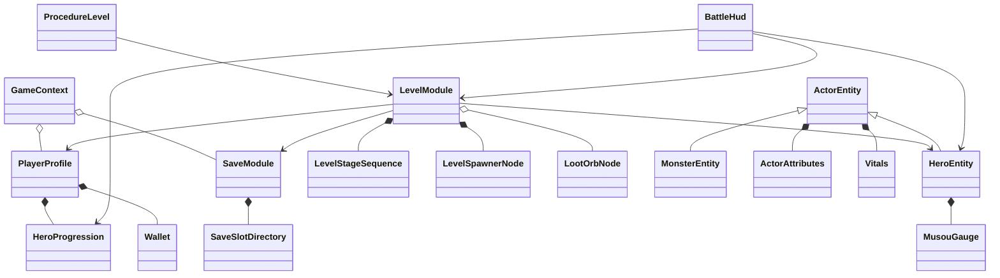
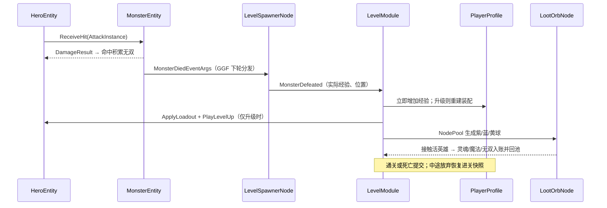

# 项目导览

先读本页，再沿代码入口追一次启动和击杀。唯一规范是 [ProjectGuidelines/AGENTS.md](ProjectGuidelines/AGENTS.md)；官方数值看 [OfficialReference](OfficialReference.md)，素材出处看 [LegacyAssetMap](LegacyAssetMap.md)，检查命令看 [Validation](Validation.md)。

## 启动与返回

`Launch → Update → Preload → Title（开始、六格存档）→ LoadProfile → 新档 Character / 已有档 Map → 点击花果山 → Level`。

当前只有悟空和花果山开放。未解锁角色无交互；选角卡片自带姓名，悬停显示颜色和 1P。关卡清场后靠近出口、落地按 W，待掉落拾取和检查点完成即回地图；死亡保留收益并重开，设置中途返回则回滚。

## 对象与状态归属

| 状态 | 所有者 / 生命周期 |
| --- | --- |
| 累计经验、英雄列表、灵魂 | PlayerProfile / 读档到返回标题；检查点保存 |
| 阶段、结局、进关快照、在场球 | LevelModule / 本次关卡 |
| 最终属性、生命魔法、无双 | ActorEntity、HeroEntity / Show 到 Hide，不写盘 |
| 残影、闪烁、血条淡出 | 表现节点 / 关闭、隐藏或复用时复位 |

流程只装配、导航和逆序释放；LevelModule 管本关，SaveModule 管读写。每份状态一个所有者，通过方法修改，Changed 后观察者读取完整快照。纯状态与规则不访问场景树。

## 按顺序阅读

| 入口 | 要看清的问题 |
| --- | --- |
| [GameData](../Godot/GodotProject/TheGame/GameScripts/Save/Data/GameData.cs) | 完整写盘字段：ActiveHeroId、Heroes 的 ID/累计经验、Soul；配套 HeroSaveData 同文件 |
| [SaveModule](../Godot/GodotProject/TheGame/GameScripts/Save/SaveModule.cs) 和 [Save/README](../Godot/GodotProject/TheGame/GameScripts/Save/README.md) | 六格目录、读档/建档、快照写盘；当前 v4，不兼容旧格式 |
| [GameContext](../Godot/GodotProject/TheGame/GameScripts/GameContext.cs) | 档案与本槽保存入口怎样跨关卡保留 |
| [ProcedureLevel](../Godot/GodotProject/TheGame/MainPack/Scripts/Procedure/ProcedureLevel.cs) | 加载场景、显示英雄、启动关卡、打开 HUD，失败时清理 |
| [LevelModule](../Godot/GodotProject/TheGame/GameScripts/Level/LevelModule.cs) 及 Progress/Loot partial | 相机抵达、开战、清波、奖励、出口、提交与回滚 |
| [ActorEntity](../Godot/GodotProject/TheGame/GameScripts/Entity/ActorEntity.cs) | 出招快照、判定去重、DamageHelper、扣血与死亡事实 |
| [HeroEntity](../Godot/GodotProject/TheGame/GameScripts/Entity/Heroes/HeroEntity.cs) | 输入、身体状态、无双秒制计时与加成 |
| [BattleHud.Logic](../Godot/GodotProject/TheGame/GameScripts/UI/BattleHud/BattleHud.Logic.cs) | 订阅、立即刷新、关闭退订；控件只接收数值 |

## 追一次击杀

跨模块的一次性结果用 GF.Event，状态变化用 Changed，所属模块协作用直接调用。池化事件不跨 await 保存；测试读取 IFsm、节点或反射，不加生产观测接口。

## 文件放哪里

| 功能 | 目录（相对 GameScripts） |
| --- | --- |
| 属性、资源、攻击与伤害规则 | Battle/{Attributes,Resources,Attacks,Damage} |
| 档案成长与钱包 | Profile |
| 保存入口、DTO、目录显示 | Save 根目录、Data、Slots |
| 英雄/怪物与身体/AI | Entity/{Heroes,Monsters,Body} |
| 关卡入口 | Level/LevelModule*.cs |
| 关卡内部功能 | Level/{Camera,Spawning,Stages,Markers,Exit}，详见 [Level/README](../Godot/GodotProject/TheGame/GameScripts/Level/README.md) |
| 窗口、控件、飘字 | UI 下每窗一目录、Widgets、Damage |
| 配置输入 / 生成物 | Configs/GameConfig/Datas/*.xlsx / GameProto 和 DataTables |

Module 是模块入口，Node 是内部 Godot 组件，Helper 是无状态方法，Resource 是资源。按功能聚合，不把所有节点集中到 Nodes。身体状态表达动作与打断；BodyFsmHelper 的 C# 14 扩展成员 `fsm.Tick(dt)` 负责物理调度。

## 常改位置

- 无双数值：BattleConfig.xlsx 的 Ws 字段，含义与官方依据集中在 OfficialReference；角色参数不被开启/结束反复改写。
- 满值提示：`Sprites/UI/hud/hud_ws_full_frames.tres`；圆形范围在 BattleHud 的 m_WsMax 材质参数中改。
- 开启大立绘：`Sprites/UI/hud/musou_activation/musou_activation_frames.tres`，独立于满值闪烁。
- BOSS 条：`UIs/Widgets/encounter_health_bar.tscn`；姓名和笔刷条构成顶部组件，无生命数字。
- 地图悬停：LocationGlow.Scale 调尺寸，AnimationPlayer.SpeedScale 调速度；命中跟随可见轮廓。
- 新持久字段：领域状态 → GameData → ProfileSaveHelper 双向映射/回滚 → 格式版本与验证。

在 Godot 对 `TheGame/Scenes/TestArena.tscn` 按 F6 可观察战斗，它只创建内存档案。正式流程断点从 ProcedureLevel、OnHitLanded、OnMonsterDefeated、AddExperience、SubmitOutcome 开始。后续系统落位见规范第 60 章。
