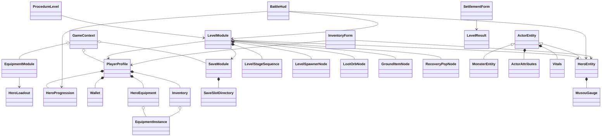
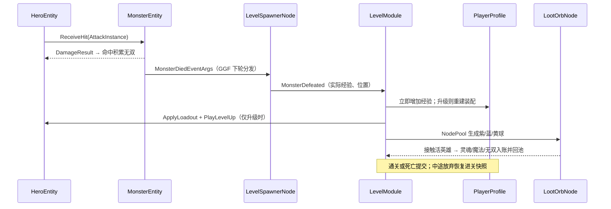

# 项目导览

先读本页，再沿代码入口追一次启动和击杀。唯一规范是 [ProjectGuidelines/AGENTS.md](ProjectGuidelines/AGENTS.md)；官方数值看 [OfficialReference](OfficialReference.md)，素材出处看 [LegacyAssetMap](LegacyAssetMap.md)，检查命令看 [Validation](Validation.md)。

## 启动与返回

`Launch → Update → Preload → Title（开始、六格存档）→ LoadProfile → 新档 Character / 已有档 Map → 点击花果山 → Level`。

当前只有悟空和花果山开放。未解锁角色无交互；选角卡片自带姓名，悬停显示颜色和 1P。关卡清场后靠近出口、落地按 W，待掉落拾取后显示成功结算；死亡保留收益并显示失败结算。成功返回地图，失败可重试或返回地图；导航等待检查点完成。设置中途返回仍回滚。

## 对象与状态归属

| 状态 | 所有者 / 生命周期 |
| --- | --- |
| 累计经验、英雄列表、灵魂、装备实例 | PlayerProfile / 读档到返回标题；检查点保存 |
| 阶段、结局、进关快照、球和地面物品 | LevelModule / 本次关卡 |
| 最终属性、生命魔法、无双 | ActorEntity、HeroEntity / Show 到 Hide，不写盘 |
| 残影、闪烁、血条淡出 | 表现节点 / 关闭、隐藏或复用时复位 |

流程只装配、导航和逆序释放；LevelModule 管本关，SaveModule 管读写。每份状态一个所有者，通过方法修改，Changed 后观察者读取完整快照。纯状态与规则不访问场景树。

## 按顺序阅读

| 入口 | 要看清的问题 |
| --- | --- |
| [GameData](../Godot/GodotProject/TheGame/GameScripts/Save/Data/GameData.cs) | 完整写盘字段：ActiveHeroId、Heroes 的 ID/累计经验、Soul、EquipmentItems 及实际属性；配套记录同文件 |
| [SaveModule](../Godot/GodotProject/TheGame/GameScripts/Save/SaveModule.cs) 和 [Save/README](../Godot/GodotProject/TheGame/GameScripts/Save/README.md) | 六格目录、读档/建档、快照写盘；当前 v6，不兼容旧格式 |
| [GameContext](../Godot/GodotProject/TheGame/GameScripts/GameContext.cs) | 档案与本槽保存入口怎样跨关卡保留 |
| [ProcedureLevel](../Godot/GodotProject/TheGame/MainPack/Scripts/Procedure/ProcedureLevel.cs) | 加载场景、显示英雄、启动关卡、打开 HUD，失败时清理 |
| [LevelModule](../Godot/GodotProject/TheGame/GameScripts/Level/LevelModule.cs) 及 Progress/Loot partial | 相机抵达、开战、清波、奖励、出口、提交与回滚 |
| [ActorEntity](../Godot/GodotProject/TheGame/GameScripts/Entity/ActorEntity.cs) | 出招快照、判定去重、DamageHelper、扣血与死亡事实 |
| [HeroEntity](../Godot/GodotProject/TheGame/GameScripts/Entity/Heroes/HeroEntity.cs) | 输入、身体状态、无双秒制计时与加成 |
| [BattleHud.Logic](../Godot/GodotProject/TheGame/GameScripts/UI/BattleHud/BattleHud.Logic.cs) | 订阅、立即刷新、关闭退订；控件只接收数值 |
| [EquipmentModule](../Godot/GodotProject/TheGame/GameScripts/Equipment/EquipmentModule.cs) | 装备定义、官方随机属性与读档校验；出战和升级共用 CreateLoadout |
| [InventoryForm.Logic](../Godot/GodotProject/TheGame/GameScripts/UI/InventoryForm/InventoryForm.Logic.cs) | 实际属性、经验、灵魂和装备格；悬停查看本件实际值；打开暂停，关闭退订 |
| [SettlementForm.Logic](../Godot/GodotProject/TheGame/GameScripts/UI/SettlementForm/SettlementForm.Logic.cs) | 只读冻结的 LevelResult，提交带窗口编号的地图或重试事件 |

背包场景按 `Window / CharacterPanel（Identity、EquipmentSlots、Attributes、Experience）/ BagPanel（Tabs、m_BagGrid、Footer）` 分组；出售确认独立为 `m_SaleConfirmation / Center / Panel / Content（标题、摘要、说明、Actions）`，全屏遮罩阻挡背后点击。每项属性有独立的 Caption 与数值 Label。外置 `hero_preview.tscn` 和动画库只含身体、武器与光效表现，不创建第二个战斗实体。

预览采用独立场景组合，动画保存为外置资源；参考 Godot 官方的 [场景组织](https://docs.godotengine.org/en/stable/tutorials/best_practices/scene_organization.html) 与 [Resources](https://docs.godotengine.org/en/stable/tutorials/scripting/resources.html)。数值配置和档案所有权仍遵循本项目的 Luban 与 PlayerProfile 约定。

背包显示悟空、唐僧的粗糙/普通装备共八种；详情显示实例的具名实际属性。点击格子打开装备、赠送、出售菜单，单人赠送禁用，异角色不能穿戴。武器与防具独立换装；替换时旧装备回包，满包不能卸下，换装不补血。售价来自装备表（粗糙 10、普通 20 灵魂）。C 对应 inventory_toggle 输入动作，打开暂停、关闭恢复；分类可切换，装备 75 格分三页，其余分类尚无物品内容；底部两行分别放灵魂/一键出售、上一页/页数/下一页，出售向上展开各品质，选择后确认件数和收益，再提交整包交易，排除穿戴物。数值沿用造梦一，提示及操作菜单按造梦三公开原资源实现。

结算展示实际游玩秒数（不含暂停）、剩余生命比例、击败数和发放经验。连击与评分尚未实现，因此未显示虚构成绩。按本次用户要求替换第 60 章旧的自动重开/直接回地图行为，并将装配工厂从 HeroLoadout.Create 移到 EquipmentModule.CreateLoadout，HeroLoadout 保留为不可变输入；规范正文的旧描述保留待用户同步。

## 追一次击杀

跨模块的一次性结果用 GF.Event，状态变化用 Changed，所属模块协作用直接调用。池化事件不跨 await 保存；测试读取 IFsm、节点或反射，不加生产观测接口。

## 文件放哪里

| 功能 | 目录（相对 GameScripts） |
| --- | --- |
| 属性、资源、攻击与伤害规则 | Battle/{Attributes,Resources,Attacks,Damage} |
| 档案成长与钱包 | Profile |
| 保存入口、DTO、目录显示 | Save 根目录、Data、Slots |
| 英雄/怪物与身体/AI | Entity/{Heroes,Monsters,Body} |
| 关卡入口 | Level/LevelModule*.cs |
| 关卡内部功能 | Level/{Camera,Spawning,Stages,Markers,Exit}，详见 [Level/README](../Godot/GodotProject/TheGame/GameScripts/Level/README.md) |
| 窗口、控件、飘字 | UI 下每窗一目录、Widgets、Damage、Recovery |
| 配置输入 / 生成物 | Configs/GameConfig/Datas/*.xlsx / GameProto 和 DataTables |

Module 是模块入口，Node 是内部 Godot 组件，Helper 是无状态方法，Resource 是资源。按功能聚合，不把所有节点集中到 Nodes。身体状态表达动作与打断；BodyFsmHelper 的 C# 14 扩展成员 `fsm.Tick(dt)` 负责物理调度。

## 常改位置

- 无双数值：BattleConfig.xlsx 的 Ws 字段，含义与官方依据集中在 OfficialReference；角色参数不被开启/结束反复改写。
- 满值提示：`Sprites/UI/hud/hud_ws_full_frames.tres`；圆形范围在 BattleHud 的 m_WsMax 材质参数中改。
- 开启大立绘：`Sprites/UI/hud/musou_activation/musou_activation_frames.tres`，独立于满值闪烁。
- BOSS 条：`UIs/Widgets/encounter_health_bar.tscn`；姓名和笔刷条构成顶部组件，无生命数字。
- 地图悬停：LocationGlow.Scale 调尺寸，AnimationPlayer.SpeedScale 调速度；命中跟随可见轮廓。
- 新持久字段：领域状态 → GameData → ProfileSaveHelper 双向映射/回滚 → 格式版本与验证。
- 悟空动作：先看 [官方五段攻击](OfficialReference.md#悟空五段普攻)，再看 [独立图集及原点](LegacyAssetMap.md#悟空独立身体与武器)；AnimationLibrary 管帧/特效/判定，AttackConfig 管威力/击退/声音，身体状态只驱动动作。

在 Godot 对 `TheGame/Scenes/TestArena.tscn` 按 F6 可观察战斗，它只创建内存档案。正式流程断点从 ProcedureLevel、OnHitLanded、OnMonsterDefeated、AddExperience、SubmitOutcome 开始。后续系统落位见规范第 60 章。

## 地面物品与地图提示

装备在死亡时生成唯一实例并抽属性；`LootHelper.RollGround` 只选择定义，`LevelModule.Loot` 借助 GGF 节点池创建和拥有 `GroundItemNode`。物品受重力落地，接触后才恢复或入包，暂停时不计过期，10 秒未领取回收。地面只显示官方掉落图，不显示名称；背包使用另一套原版图标。满包不销毁、不重抽；出口只等飞行球，不等待未拾取的地面物品。

当前保存格式 v6：GameData 平铺英雄经验、灵魂、装备实例及具名属性；Heroes 中以实例 Guid 引用穿戴物。PlayerProfile.Inventory 只含未穿戴物，HeroEquipment 保存穿戴；HeroLoadout 将基础属性和当前两件装备冻结后交给实体。旧格式不做运行时兼容。已按用户授权备份原 v4 开发档，再一次性转存累计经验 1020 和灵魂 835；原件保留在 GameData.backup-before-v6-20261013-025550，正式主档与备份均经 v6 读取验证。第 20/30/50/60/70 章旧名称与版本尚未同步，本轮只按用户明确要求补充第 40 章美术定位规则。

地图打开和鼠标离开后播放外置 `location/current` 边缘闪烁，悬停播放 `location/hover`；关闭时 RESET 并停止，复用重新启动。当前只有花果山开放，因此最新提示就是花果山；多关解锁进度尚未实现，不新增虚构进度字段。用户当前指令覆盖第 40 章旧的离开即停止提示描述；规范正文未自行修改。

恢复品和蓝球实际领取后，由本关创建 RecoveryPopNode：生命数字绿色，魔法数字蓝色；显示配置恢复量（即使已达上限），一秒上移 75px，暂停停止，关卡结束回收。

怪物 AI 的范围与目标盒直接使用 `Godot.Rect2`（纯 C# 值类型，不依赖场景树），合并/中心/空矩形采用原生 API。`AttackReachHelper` 只补朝向镜像与有符号间隙；不再维护重复的 AiBox 结构。
